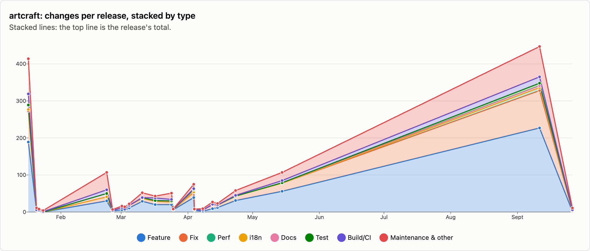
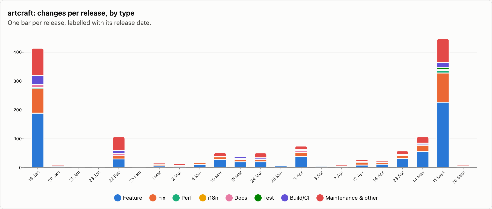
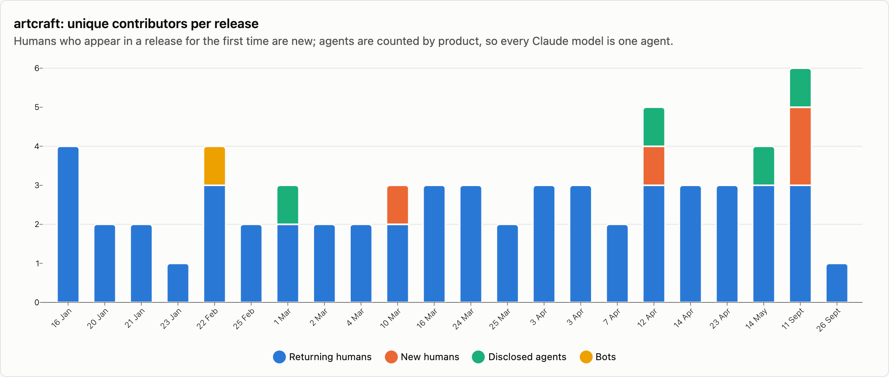
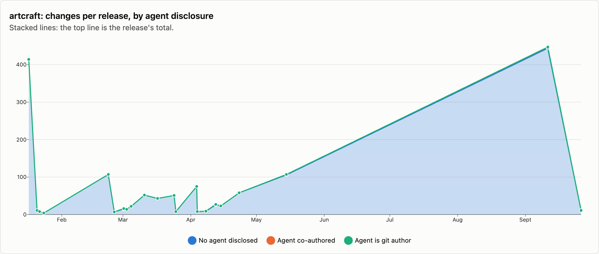

# artcraft — changes per release

23 releases, 2025-07-14 → 2026-09-26. Each release is counted as the changes that landed between the previous release tag and its own; the first one is everything up to the first tag. See [../README.md](../README.md) for how changes are counted and categorised. The charts cover released changes; the commentary under them is generated from the same numbers.

## Changes by type

<picture>
  <source media="(prefers-color-scheme: dark)" srcset="../charts/dark/artcraft-changes-line.png">
  
</picture>

<picture>
  <source media="(prefers-color-scheme: dark)" srcset="../charts/dark/artcraft-changes-bar.png">
  
</picture>

**What this shows**

- artcraft has had 22 releases with 1,522 changes in total, over 253 days.
- The first release, v0.0.1 (14 Jul), is left out of everything below: its 10,033 changes of older history were counted but not sorted into types.
- The biggest release was v0.37.0 (11 Sep) with 447 changes, which is 29% of everything released so far.
- Release size has stayed fairly steady: the first 11 releases averaged 63 changes each and the last 11 releases averaged 75.
- Overall, features make up 47% of changes and fixes 20%.
- The balance between features and fixes has not changed much: features went from 43% of changes in the first 11 releases to 50% in the last 11 releases, and fixes from 19% to 22%.
- Performance work is rare: 14 changes.
- After features and fixes, the next biggest group is clean-up at 10%.
- Since the last release, 15 more changes have landed on main and not been released yet: 7 features and 3 fixes among them.

| Release | Published | Changes | Feature | Fix | Perf | i18n | Docs | Test | Build/CI | Release | Refactor | Deps | Security | Revert | Other |
|---|--:|--:|--:|--:|--:|--:|--:|--:|--:|--:|--:|--:|--:|--:|--:|
| [artcraft-v0.0.1 (+win)](https://github.com/storytold/artcraft/releases/tag/artcraft-v0.0.1) | 2025-07-14 | 10033 | – | – | – | – | – | – | – | – | – | – | – | – | – |
| [artcraft-v0.2.0 (+win)](https://github.com/storytold/artcraft/releases/tag/artcraft-v0.2.0) | 2026-01-16 | 414 | 189 | 84 | 4 | · | 11 | 1 | 30 | 18 | 42 | 5 | · | 1 | 29 |
| [artcraft-v0.3.0 (+win)](https://github.com/storytold/artcraft/releases/tag/artcraft-v0.3.0) | 2026-01-20 | 11 | 5 | · | · | · | 1 | · | · | 1 | 2 | 1 | · | · | 1 |
| [artcraft-v0.4.0 (+win)](https://github.com/storytold/artcraft/releases/tag/artcraft-v0.4.0) | 2026-01-21 | 8 | 2 | 2 | · | · | · | · | 1 | 2 | 1 | · | · | · | · |
| [artcraft-v0.5.0 (+win)](https://github.com/storytold/artcraft/releases/tag/artcraft-v0.5.0) | 2026-01-23 | 4 | · | · | · | · | · | · | 1 | 2 | · | · | · | · | 1 |
| [artcraft-v0.7.0](https://github.com/storytold/artcraft/releases/tag/artcraft-v0.7.0) | 2026-02-22 | 107 | 30 | 11 | · | · | 9 | · | 10 | 3 | 7 | 7 | · | 4 | 26 |
| [artcraft-v0.8.0](https://github.com/storytold/artcraft/releases/tag/artcraft-v0.8.0) | 2026-02-25 | 7 | 3 | 1 | · | · | · | · | · | 2 | · | · | · | · | 1 |
| [artcraft-v0.10.0](https://github.com/storytold/artcraft/releases/tag/artcraft-v0.10.0) | 2026-03-01 | 16 | 6 | 6 | · | · | · | · | · | 2 | · | · | · | · | 2 |
| [artcraft-v0.11.0](https://github.com/storytold/artcraft/releases/tag/artcraft-v0.11.0) | 2026-03-02 | 14 | 5 | 3 | · | · | · | · | · | 1 | 3 | · | · | · | 2 |
| [artcraft-v0.12.0](https://github.com/storytold/artcraft/releases/tag/artcraft-v0.12.0) | 2026-03-04 | 22 | 11 | 6 | · | · | · | 1 | · | 3 | 1 | · | · | · | · |
| [artcraft-v0.14.0](https://github.com/storytold/artcraft/releases/tag/artcraft-v0.14.0) | 2026-03-10 | 52 | 29 | 8 | · | · | 2 | · | · | 2 | 1 | · | · | · | 10 |
| [artcraft-v0.15.0](https://github.com/storytold/artcraft/releases/tag/artcraft-v0.15.0) | 2026-03-16 | 43 | 20 | 9 | 1 | · | 1 | · | 7 | 1 | 1 | 1 | · | 1 | 1 |
| [artcraft-v0.19.0](https://github.com/storytold/artcraft/releases/tag/artcraft-v0.19.0) | 2026-03-24 | 51 | 20 | 7 | · | · | 2 | 1 | 4 | 4 | 10 | 3 | · | · | · |
| [artcraft-v0.20.0](https://github.com/storytold/artcraft/releases/tag/artcraft-v0.20.0) | 2026-03-25 | 8 | 6 | 1 | · | · | · | · | · | 1 | · | · | · | · | · |
| [artcraft-v0.22.0](https://github.com/storytold/artcraft/releases/tag/artcraft-v0.22.0) | 2026-04-03 | 75 | 39 | 14 | 1 | · | 6 | 1 | 2 | 3 | 8 | · | · | · | 1 |
| [artcraft-v0.23.0](https://github.com/storytold/artcraft/releases/tag/artcraft-v0.23.0) | 2026-04-03 | 8 | 5 | 2 | · | · | · | · | · | 1 | · | · | · | · | · |
| [artcraft-v0.24.0](https://github.com/storytold/artcraft/releases/tag/artcraft-v0.24.0) | 2026-04-07 | 9 | 2 | 3 | · | · | · | · | · | 2 | 2 | · | · | · | · |
| [artcraft-v0.27.0](https://github.com/storytold/artcraft/releases/tag/artcraft-v0.27.0) | 2026-04-12 | 27 | 9 | 10 | · | · | · | 2 | · | 3 | 2 | · | · | · | 1 |
| [artcraft-v0.28.0](https://github.com/storytold/artcraft/releases/tag/artcraft-v0.28.0) | 2026-04-14 | 23 | 12 | 6 | · | · | 1 | · | · | 1 | 2 | · | · | · | 1 |
| [artcraft-v0.29.0](https://github.com/storytold/artcraft/releases/tag/artcraft-v0.29.0) | 2026-04-23 | 58 | 31 | 12 | · | · | · | · | 2 | 1 | 9 | · | · | · | 3 |
| [artcraft-v0.32.0](https://github.com/storytold/artcraft/releases/tag/artcraft-v0.32.0) | 2026-05-14 | 107 | 56 | 22 | · | · | 1 | · | 6 | 3 | 9 | · | 1 | · | 9 |
| [artcraft-v0.37.0](https://github.com/storytold/artcraft/releases/tag/artcraft-v0.37.0) | 2026-09-11 | 447 | 227 | 101 | 8 | · | 5 | 7 | 17 | 6 | 51 | 2 | 1 | 4 | 18 |
| [artcraft-v0.41.0](https://github.com/storytold/artcraft/releases/tag/artcraft-v0.41.0) | 2026-09-26 | 11 | 2 | 2 | · | · | 2 | · | · | 4 | · | · | · | · | 1 |
| _unreleased (main)_ | 2026-10-11 | 15 | 7 | 3 | 2 | · | 1 | · | 1 | 1 | · | · | · | · | · |
| **Released total** |  | **1522** | **709** | **310** | **14** | · | **41** | **13** | **80** | **66** | **151** | **19** | **2** | **10** | **107** |

`–` = not categorised: the first ArtCraft release sits on top of ~13,400 commits of earlier monorepo history (2015–2025), which is counted but not labelled.

Share of released changes: feature 47%, fix 20%, perf 1%, docs 3%, test 1%, build/ci 5%, release 4%, refactor 10%, deps 1%, revert 1%, other 7%.

## How changes landed

**What this shows**

- 66% of changes came in through pull requests; the rest were committed directly.
- That has grown: pull requests were 52% of changes in the first 11 releases and 78% in the last 11 releases.
- Of the 1,007 pull requests, 5% came from people outside the core team.

| Release | Commits | PR merges | Squash merges | Direct commits | Batch commits | Commits inside PRs | Sync merges | Community PRs | Team PRs |
|---|--:|--:|--:|--:|--:|--:|--:|--:|--:|
| [artcraft-v0.0.1 (+win)](https://github.com/storytold/artcraft/releases/tag/artcraft-v0.0.1) | 13463 | 977 | 776 | 8074 | 206 | 2980 | 450 | 731 | 934 |
| [artcraft-v0.2.0 (+win)](https://github.com/storytold/artcraft/releases/tag/artcraft-v0.2.0) | 414 | · | 238 | 176 | · | · | · | · | 238 |
| [artcraft-v0.3.0 (+win)](https://github.com/storytold/artcraft/releases/tag/artcraft-v0.3.0) | 11 | · | 6 | 5 | · | · | · | · | 6 |
| [artcraft-v0.4.0 (+win)](https://github.com/storytold/artcraft/releases/tag/artcraft-v0.4.0) | 8 | · | 4 | 4 | · | · | · | · | 4 |
| [artcraft-v0.5.0 (+win)](https://github.com/storytold/artcraft/releases/tag/artcraft-v0.5.0) | 4 | · | 1 | 3 | · | · | · | · | 1 |
| [artcraft-v0.7.0](https://github.com/storytold/artcraft/releases/tag/artcraft-v0.7.0) | 107 | · | 36 | 71 | · | · | · | 3 | 33 |
| [artcraft-v0.8.0](https://github.com/storytold/artcraft/releases/tag/artcraft-v0.8.0) | 7 | · | 4 | 3 | · | · | · | · | 4 |
| [artcraft-v0.10.0](https://github.com/storytold/artcraft/releases/tag/artcraft-v0.10.0) | 16 | · | 10 | 6 | · | · | · | · | 10 |
| [artcraft-v0.11.0](https://github.com/storytold/artcraft/releases/tag/artcraft-v0.11.0) | 14 | · | 5 | 9 | · | · | · | · | 5 |
| [artcraft-v0.12.0](https://github.com/storytold/artcraft/releases/tag/artcraft-v0.12.0) | 22 | · | 11 | 11 | · | · | · | · | 11 |
| [artcraft-v0.14.0](https://github.com/storytold/artcraft/releases/tag/artcraft-v0.14.0) | 53 | · | 32 | 20 | · | · | 1 | 1 | 31 |
| [artcraft-v0.15.0](https://github.com/storytold/artcraft/releases/tag/artcraft-v0.15.0) | 43 | · | 19 | 24 | · | · | · | · | 19 |
| [artcraft-v0.19.0](https://github.com/storytold/artcraft/releases/tag/artcraft-v0.19.0) | 51 | · | 37 | 14 | · | · | · | · | 37 |
| [artcraft-v0.20.0](https://github.com/storytold/artcraft/releases/tag/artcraft-v0.20.0) | 8 | · | 6 | 2 | · | · | · | · | 6 |
| [artcraft-v0.22.0](https://github.com/storytold/artcraft/releases/tag/artcraft-v0.22.0) | 75 | · | 58 | 17 | · | · | · | · | 58 |
| [artcraft-v0.23.0](https://github.com/storytold/artcraft/releases/tag/artcraft-v0.23.0) | 9 | · | 4 | 4 | · | · | 1 | · | 4 |
| [artcraft-v0.24.0](https://github.com/storytold/artcraft/releases/tag/artcraft-v0.24.0) | 9 | · | 6 | 3 | · | · | · | · | 6 |
| [artcraft-v0.27.0](https://github.com/storytold/artcraft/releases/tag/artcraft-v0.27.0) | 27 | · | 23 | 4 | · | · | · | 1 | 22 |
| [artcraft-v0.28.0](https://github.com/storytold/artcraft/releases/tag/artcraft-v0.28.0) | 23 | · | 21 | 2 | · | · | · | · | 21 |
| [artcraft-v0.29.0](https://github.com/storytold/artcraft/releases/tag/artcraft-v0.29.0) | 58 | · | 47 | 11 | · | · | · | · | 47 |
| [artcraft-v0.32.0](https://github.com/storytold/artcraft/releases/tag/artcraft-v0.32.0) | 107 | · | 69 | 38 | · | · | · | · | 69 |
| [artcraft-v0.37.0](https://github.com/storytold/artcraft/releases/tag/artcraft-v0.37.0) | 447 | · | 360 | 87 | · | · | · | 43 | 317 |
| [artcraft-v0.41.0](https://github.com/storytold/artcraft/releases/tag/artcraft-v0.41.0) | 11 | · | 10 | 1 | · | · | · | · | 10 |
| _unreleased (main)_ | 15 | · | 15 | · | · | · | · | · | 15 |
| **Released total** | **14987** | **977** | **1783** | **8589** | **206** | **2980** | **452** | **779** | **1893** |

Changes = PR merges + squash merges + direct commits + batch commits. Commits = changes + commits inside PRs + sync merges.

## Contributors

<picture>
  <source media="(prefers-color-scheme: dark)" srcset="../charts/dark/artcraft-contributors.png">
  
</picture>

<picture>
  <source media="(prefers-color-scheme: dark)" srcset="../charts/dark/artcraft-agent-disclosure.png">
  
</picture>

**What this shows**

- 8 people have contributed to released changes.
- The first release had 4 people and the latest had 1; the most in one release was 5, in v0.37.0 (11 Sep).
- Nobody in the latest release was a first-time contributor.
- The most active person, @echelon, authored 60% of all changes, and the three most active authored 97% between them.
- Under 1% of changes say an AI agent was involved (6 of 1,522).
- That share has stayed about the same over time (under 1% in the first 11 releases, under 1% in the last 11 releases).
- Claude accounts for all of the changes that name an agent.
- These figures only count changes that say so, so the real share may be higher.

| Release | Humans | New | Changes disclosing an agent | Share | Agent is git author | Agents disclosed | Bots |
|---|--:|--:|--:|--:|--:|---|--:|
| [artcraft-v0.0.1 (+win)](https://github.com/storytold/artcraft/releases/tag/artcraft-v0.0.1) | 34 | 34 | · | 0% | · | · | 1 |
| [artcraft-v0.2.0 (+win)](https://github.com/storytold/artcraft/releases/tag/artcraft-v0.2.0) | 4 | · | · | 0% | · | · | · |
| [artcraft-v0.3.0 (+win)](https://github.com/storytold/artcraft/releases/tag/artcraft-v0.3.0) | 2 | · | · | 0% | · | · | · |
| [artcraft-v0.4.0 (+win)](https://github.com/storytold/artcraft/releases/tag/artcraft-v0.4.0) | 2 | · | · | 0% | · | · | · |
| [artcraft-v0.5.0 (+win)](https://github.com/storytold/artcraft/releases/tag/artcraft-v0.5.0) | 1 | · | · | 0% | · | · | · |
| [artcraft-v0.7.0](https://github.com/storytold/artcraft/releases/tag/artcraft-v0.7.0) | 3 | · | · | 0% | · | · | 1 |
| [artcraft-v0.8.0](https://github.com/storytold/artcraft/releases/tag/artcraft-v0.8.0) | 2 | · | · | 0% | · | · | · |
| [artcraft-v0.10.0](https://github.com/storytold/artcraft/releases/tag/artcraft-v0.10.0) | 2 | · | 1 | 6% | · | Claude | · |
| [artcraft-v0.11.0](https://github.com/storytold/artcraft/releases/tag/artcraft-v0.11.0) | 2 | · | · | 0% | · | · | · |
| [artcraft-v0.12.0](https://github.com/storytold/artcraft/releases/tag/artcraft-v0.12.0) | 2 | · | · | 0% | · | · | · |
| [artcraft-v0.14.0](https://github.com/storytold/artcraft/releases/tag/artcraft-v0.14.0) | 3 | 1 | · | 0% | · | · | · |
| [artcraft-v0.15.0](https://github.com/storytold/artcraft/releases/tag/artcraft-v0.15.0) | 3 | · | · | 0% | · | · | · |
| [artcraft-v0.19.0](https://github.com/storytold/artcraft/releases/tag/artcraft-v0.19.0) | 3 | · | · | 0% | · | · | · |
| [artcraft-v0.20.0](https://github.com/storytold/artcraft/releases/tag/artcraft-v0.20.0) | 2 | · | · | 0% | · | · | · |
| [artcraft-v0.22.0](https://github.com/storytold/artcraft/releases/tag/artcraft-v0.22.0) | 3 | · | · | 0% | · | · | · |
| [artcraft-v0.23.0](https://github.com/storytold/artcraft/releases/tag/artcraft-v0.23.0) | 3 | · | · | 0% | · | · | · |
| [artcraft-v0.24.0](https://github.com/storytold/artcraft/releases/tag/artcraft-v0.24.0) | 2 | · | · | 0% | · | · | · |
| [artcraft-v0.27.0](https://github.com/storytold/artcraft/releases/tag/artcraft-v0.27.0) | 4 | 1 | 1 | 4% | · | Claude | · |
| [artcraft-v0.28.0](https://github.com/storytold/artcraft/releases/tag/artcraft-v0.28.0) | 3 | · | · | 0% | · | · | · |
| [artcraft-v0.29.0](https://github.com/storytold/artcraft/releases/tag/artcraft-v0.29.0) | 3 | · | · | 0% | · | · | · |
| [artcraft-v0.32.0](https://github.com/storytold/artcraft/releases/tag/artcraft-v0.32.0) | 3 | · | 1 | <1% | · | Claude | · |
| [artcraft-v0.37.0](https://github.com/storytold/artcraft/releases/tag/artcraft-v0.37.0) | 5 | 2 | 3 | <1% | · | Claude | · |
| [artcraft-v0.41.0](https://github.com/storytold/artcraft/releases/tag/artcraft-v0.41.0) | 1 | · | · | 0% | · | · | · |
| _unreleased (main)_ | 4 | 1 | 4 | 27% | · | Claude | · |
| **Released total** | **8** |  | **6** | <1% | **0** | Claude | 1 |

Humans are unique people per release, authors and co-authors together; New is how many of them had not appeared in an earlier release of this repo. The total row counts each person once. An agent is disclosed when it is a commit's git author, is named in a `Co-authored-by` trailer, or the message says it was generated with one.

Most active humans in released changes: @echelon (924), @bflatastic (496), @tanish2k09 (72), @h-a-n-a-s-h-i (46), @kasisnu (2), @amitkojha05 (1), @frankywashere (1), @jtoy (1).
