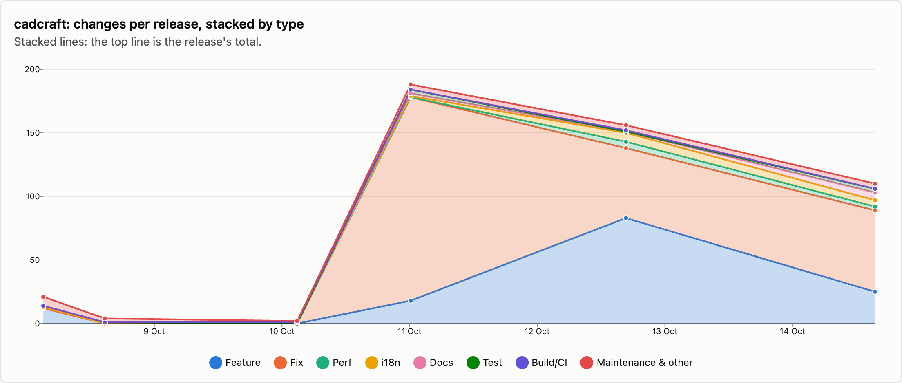
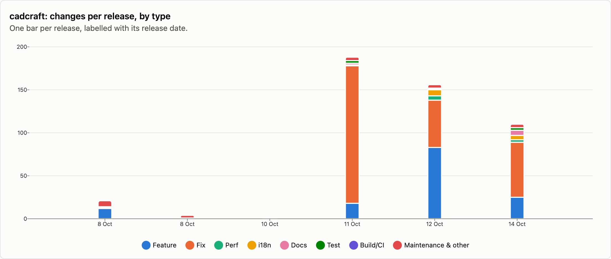
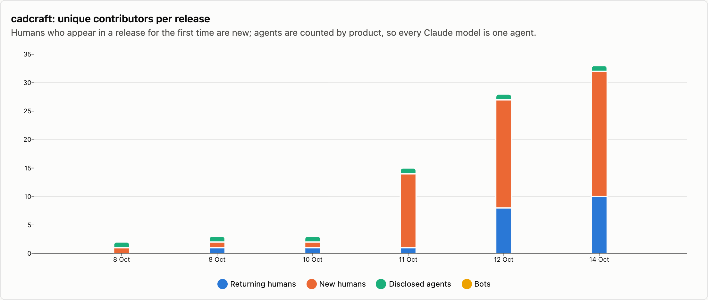
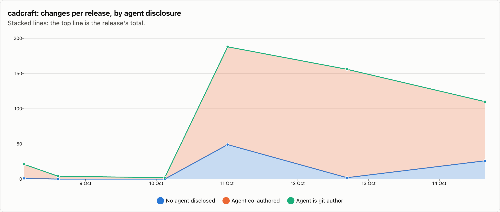

# cadcraft — changes per release

6 releases, 2026-10-08 → 2026-10-14. Each release is counted as the changes that landed between the previous release tag and its own; the first one is everything up to the first tag. See [../README.md](../README.md) for how changes are counted and categorised. The charts cover released changes; the commentary under them is generated from the same numbers.

## Changes by type

<picture>
  <source media="(prefers-color-scheme: dark)" srcset="../charts/dark/cadcraft-changes-line.png">
  
</picture>

<picture>
  <source media="(prefers-color-scheme: dark)" srcset="../charts/dark/cadcraft-changes-bar.png">
  
</picture>

**What this shows**

- cadcraft has had 6 releases with 481 changes in total, over 6 days.
- The biggest release was v0.5.0 (11 Oct) with 188 changes, which is 39% of everything released so far.
- Releases are getting bigger: the first 3 releases averaged 9 changes each and the last 3 releases averaged 151.
- Overall, fixes make up 58% of changes and features 29%.
- The work has shifted from building new things to fixing: features went from 44% of changes in the first 3 releases to 28% in the last 3 releases, and fixes from 0% to 61%.
- Performance work is rare: 9 changes.
- Since the last release, 2 more changes have landed on main and not been released yet: 0 features and 1 fix among them.

| Release | Published | Changes | Feature | Fix | Perf | i18n | Docs | Test | Build/CI | Release | Refactor | Deps | Security | Revert | Other |
|---|--:|--:|--:|--:|--:|--:|--:|--:|--:|--:|--:|--:|--:|--:|--:|
| [v0.1.0](https://github.com/storytold/cadcraft/releases/tag/v0.1.0) | 2026-10-08 | 21 | 12 | · | 1 | · | 1 | · | · | 4 | 1 | · | · | · | 2 |
| [v0.3.0](https://github.com/storytold/cadcraft/releases/tag/v0.3.0) | 2026-10-08 | 4 | · | · | · | · | 1 | · | · | 3 | · | · | · | · | · |
| [v0.4.0](https://github.com/storytold/cadcraft/releases/tag/v0.4.0) | 2026-10-10 | 2 | · | · | · | · | · | · | 1 | 1 | · | · | · | · | · |
| [v0.5.0](https://github.com/storytold/cadcraft/releases/tag/v0.5.0) | 2026-10-11 | 188 | 18 | 160 | · | 1 | 2 | 3 | · | 1 | 3 | · | · | · | · |
| [v0.6.2](https://github.com/storytold/cadcraft/releases/tag/v0.6.2) | 2026-10-12 | 156 | 83 | 55 | 5 | 7 | 1 | · | 1 | 4 | · | · | · | · | · |
| [v0.7.0](https://github.com/storytold/cadcraft/releases/tag/v0.7.0) | 2026-10-14 | 110 | 25 | 64 | 3 | 5 | 6 | 3 | · | 1 | 3 | · | · | · | · |
| _unreleased (main)_ | 2026-10-15 | 2 | · | 1 | · | · | · | · | 1 | · | · | · | · | · | · |
| **Released total** |  | **481** | **138** | **279** | **9** | **13** | **11** | **6** | **2** | **14** | **7** | · | · | · | **2** |

Share of released changes: feature 29%, fix 58%, perf 2%, i18n 3%, docs 2%, test 1%, release 3%, refactor 1%.

## How changes landed

**What this shows**

- 91% of changes came in through pull requests; the rest were committed directly.
- That has grown: pull requests were 19% of changes in the first 3 releases and 96% in the last 3 releases.
- Of the 440 pull requests, 98% came from people outside the core team.
- Outside contributions have gone up: 20% of pull requests in the first 3 releases, 99% in the last 3 releases.

| Release | Commits | PR merges | Squash merges | Direct commits | Batch commits | Commits inside PRs | Sync merges | Community PRs | Team PRs |
|---|--:|--:|--:|--:|--:|--:|--:|--:|--:|
| [v0.1.0](https://github.com/storytold/cadcraft/releases/tag/v0.1.0) | 23 | · | 2 | 19 | · | · | 2 | · | 2 |
| [v0.3.0](https://github.com/storytold/cadcraft/releases/tag/v0.3.0) | 4 | · | 2 | 2 | · | · | · | · | 2 |
| [v0.4.0](https://github.com/storytold/cadcraft/releases/tag/v0.4.0) | 3 | 1 | · | 1 | · | 1 | · | 1 | · |
| [v0.5.0](https://github.com/storytold/cadcraft/releases/tag/v0.5.0) | 188 | · | 180 | 8 | · | · | · | 178 | 2 |
| [v0.6.2](https://github.com/storytold/cadcraft/releases/tag/v0.6.2) | 160 | 1 | 152 | 3 | · | 3 | 1 | 151 | 2 |
| [v0.7.0](https://github.com/storytold/cadcraft/releases/tag/v0.7.0) | 110 | · | 102 | 8 | · | · | · | 102 | · |
| _unreleased (main)_ | 3 | 1 | 1 | · | · | 1 | · | 2 | · |
| **Released total** | **488** | **2** | **438** | **41** | **0** | **4** | **3** | **432** | **8** |

Changes = PR merges + squash merges + direct commits + batch commits. Commits = changes + commits inside PRs + sync merges.

## Contributors

<picture>
  <source media="(prefers-color-scheme: dark)" srcset="../charts/dark/cadcraft-contributors.png">
  
</picture>

<picture>
  <source media="(prefers-color-scheme: dark)" srcset="../charts/dark/cadcraft-agent-disclosure.png">
  
</picture>

**What this shows**

- 57 people have contributed to released changes.
- The first release had 1 person and the latest had 32.
- In the latest release, 22 of the 32 people were contributing for the first time.
- The most active person, @vangel76, authored 41% of all changes, and the three most active authored 64% between them.
- 84% of changes say an AI agent was involved (403 of 481).
- That share has gone down: 96% in the first 3 releases and 83% in the last 3 releases.
- Claude accounts for all of the changes that name an agent.
- These figures only count changes that say so, so the real share may be higher.

| Release | Humans | New | Changes disclosing an agent | Share | Agent is git author | Agents disclosed | Bots |
|---|--:|--:|--:|--:|--:|---|--:|
| [v0.1.0](https://github.com/storytold/cadcraft/releases/tag/v0.1.0) | 1 | 1 | 20 | 95% | · | Claude | · |
| [v0.3.0](https://github.com/storytold/cadcraft/releases/tag/v0.3.0) | 2 | 1 | 4 | 100% | · | Claude | · |
| [v0.4.0](https://github.com/storytold/cadcraft/releases/tag/v0.4.0) | 2 | 1 | 2 | 100% | · | Claude | · |
| [v0.5.0](https://github.com/storytold/cadcraft/releases/tag/v0.5.0) | 14 | 13 | 139 | 74% | · | Claude | · |
| [v0.6.2](https://github.com/storytold/cadcraft/releases/tag/v0.6.2) | 27 | 19 | 154 | 99% | · | Claude | · |
| [v0.7.0](https://github.com/storytold/cadcraft/releases/tag/v0.7.0) | 32 | 22 | 84 | 76% | · | Claude | · |
| _unreleased (main)_ | 3 | · | · | 0% | · | · | · |
| **Released total** | **57** |  | **403** | 84% | **0** | Claude | · |

Humans are unique people per release, authors and co-authors together; New is how many of them had not appeared in an earlier release of this repo. The total row counts each person once. An agent is disclosed when it is a commit's git author, is named in a `Co-authored-by` trailer, or the message says it was generated with one.

Most active humans in released changes: @vangel76 (203), @echelon (115), @MarekSpodBiedry (66), @marcoarnulfo (36), @aldozar (16), @codyvogt (14), @SBaksa (14), @Tru10 (10), @LloydNicholson (8), @Ni-zav (8).
