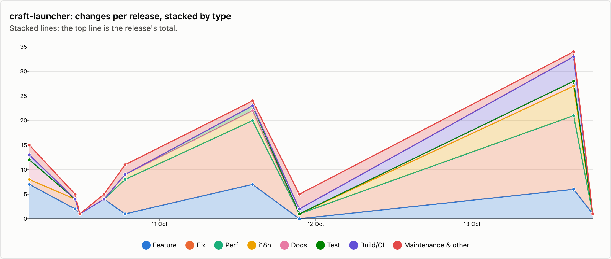
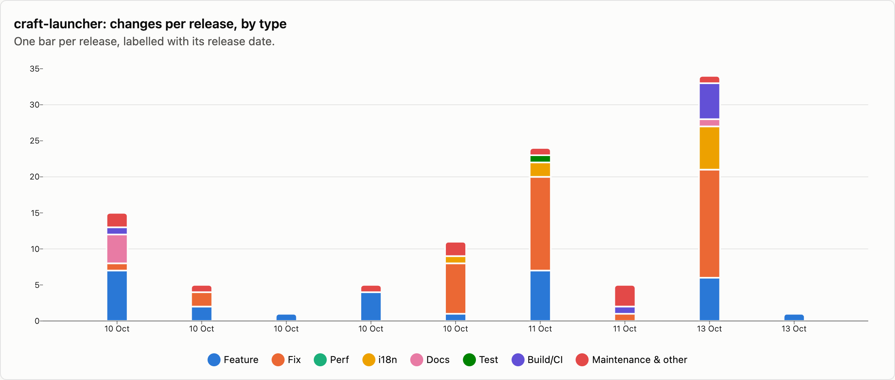
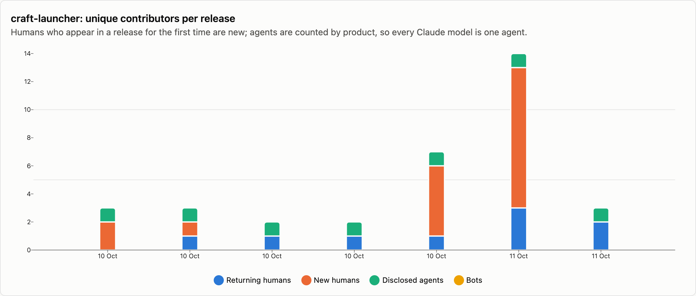
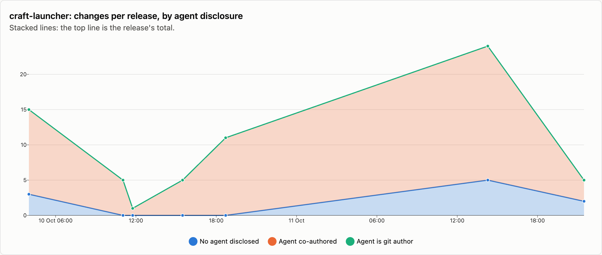

# craft-launcher — changes per release

9 releases, 2026-10-10 → 2026-10-13. Each release is counted as the changes that landed between the previous release tag and its own; the first one is everything up to the first tag. See [../README.md](../README.md) for how changes are counted and categorised. The charts cover released changes; the commentary under them is generated from the same numbers.

## Changes by type

<picture>
  <source media="(prefers-color-scheme: dark)" srcset="../charts/dark/craft-launcher-changes-line.png">
  
</picture>

<picture>
  <source media="(prefers-color-scheme: dark)" srcset="../charts/dark/craft-launcher-changes-bar.png">
  
</picture>

**What this shows**

- craft-launcher has had 9 releases with 101 changes in total, over 3 days.
- The biggest release was v0.4.0 (13 Oct) with 34 changes, which is 34% of everything released so far.
- Releases are getting bigger: the first 4 releases averaged 6 changes each and the last 4 releases averaged 16.
- Overall, fixes make up 39% of changes and features 29%.
- The work has shifted from building new things to fixing: features went from 54% of changes in the first 4 releases to 22% in the last 4 releases, and fixes from 12% to 45%.
- No change was labelled as performance work.
- After features and fixes, the next biggest group is translations at 9%.
- Since the last release, 4 more changes have landed on main and not been released yet: 1 feature and 3 fixes among them.

| Release | Published | Changes | Feature | Fix | Perf | i18n | Docs | Test | Build/CI | Release | Refactor | Deps | Security | Revert | Other |
|---|--:|--:|--:|--:|--:|--:|--:|--:|--:|--:|--:|--:|--:|--:|--:|
| [v0.1.0](https://github.com/storytold/craft-launcher/releases/tag/v0.1.0) | 2026-10-10 | 15 | 7 | 1 | · | · | 4 | · | 1 | · | · | · | · | · | 2 |
| [v0.1.1](https://github.com/storytold/craft-launcher/releases/tag/v0.1.1) | 2026-10-10 | 5 | 2 | 2 | · | · | · | · | · | 1 | · | · | · | · | · |
| [v0.1.2](https://github.com/storytold/craft-launcher/releases/tag/v0.1.2) | 2026-10-10 | 1 | 1 | · | · | · | · | · | · | · | · | · | · | · | · |
| [v0.1.3](https://github.com/storytold/craft-launcher/releases/tag/v0.1.3) | 2026-10-10 | 5 | 4 | · | · | · | · | · | · | 1 | · | · | · | · | · |
| [v0.2.0](https://github.com/storytold/craft-launcher/releases/tag/v0.2.0) | 2026-10-10 | 11 | 1 | 7 | · | 1 | · | · | · | 2 | · | · | · | · | · |
| [v0.2.1](https://github.com/storytold/craft-launcher/releases/tag/v0.2.1) | 2026-10-11 | 24 | 7 | 13 | · | 2 | · | 1 | · | · | · | · | 1 | · | · |
| [v0.3.2](https://github.com/storytold/craft-launcher/releases/tag/v0.3.2) | 2026-10-11 | 5 | · | 1 | · | · | · | · | 1 | 3 | · | · | · | · | · |
| [v0.4.0](https://github.com/storytold/craft-launcher/releases/tag/v0.4.0) | 2026-10-13 | 34 | 6 | 15 | · | 6 | 1 | · | 5 | 1 | · | · | · | · | · |
| [v0.4.1](https://github.com/storytold/craft-launcher/releases/tag/v0.4.1) | 2026-10-13 | 1 | 1 | · | · | · | · | · | · | · | · | · | · | · | · |
| _unreleased (main)_ | 2026-10-15 | 4 | 1 | 3 | · | · | · | · | · | · | · | · | · | · | · |
| **Released total** |  | **101** | **29** | **39** | · | **9** | **5** | **1** | **7** | **8** | · | · | **1** | · | **2** |

Share of released changes: feature 29%, fix 39%, i18n 9%, docs 5%, test 1%, build/ci 7%, release 8%, security 1%, other 2%.

## How changes landed

**What this shows**

- 73% of changes came in through pull requests; the rest were committed directly.
- That has grown: pull requests were 15% of changes in the first 4 releases and 95% in the last 4 releases.
- Of the 74 pull requests, 84% came from people outside the core team.
- Outside contributions have gone up: 25% of pull requests in the first 4 releases, 85% in the last 4 releases.

| Release | Commits | PR merges | Squash merges | Direct commits | Batch commits | Commits inside PRs | Sync merges | Community PRs | Team PRs |
|---|--:|--:|--:|--:|--:|--:|--:|--:|--:|
| [v0.1.0](https://github.com/storytold/craft-launcher/releases/tag/v0.1.0) | 15 | · | 1 | 14 | · | · | · | 1 | · |
| [v0.1.1](https://github.com/storytold/craft-launcher/releases/tag/v0.1.1) | 5 | · | 1 | 4 | · | · | · | · | 1 |
| [v0.1.2](https://github.com/storytold/craft-launcher/releases/tag/v0.1.2) | 1 | · | 1 | · | · | · | · | · | 1 |
| [v0.1.3](https://github.com/storytold/craft-launcher/releases/tag/v0.1.3) | 5 | · | 1 | 4 | · | · | · | · | 1 |
| [v0.2.0](https://github.com/storytold/craft-launcher/releases/tag/v0.2.0) | 11 | · | 9 | 2 | · | · | · | 9 | · |
| [v0.2.1](https://github.com/storytold/craft-launcher/releases/tag/v0.2.1) | 24 | · | 21 | 3 | · | · | · | 20 | 1 |
| [v0.3.2](https://github.com/storytold/craft-launcher/releases/tag/v0.3.2) | 5 | · | 5 | · | · | · | · | 2 | 3 |
| [v0.4.0](https://github.com/storytold/craft-launcher/releases/tag/v0.4.0) | 34 | · | 34 | · | · | · | · | 30 | 4 |
| [v0.4.1](https://github.com/storytold/craft-launcher/releases/tag/v0.4.1) | 1 | · | 1 | · | · | · | · | · | 1 |
| _unreleased (main)_ | 4 | · | 4 | · | · | · | · | 4 | · |
| **Released total** | **101** | **0** | **74** | **27** | **0** | **0** | **0** | **62** | **12** |

Changes = PR merges + squash merges + direct commits + batch commits. Commits = changes + commits inside PRs + sync merges.

## Contributors

<picture>
  <source media="(prefers-color-scheme: dark)" srcset="../charts/dark/craft-launcher-contributors.png">
  
</picture>

<picture>
  <source media="(prefers-color-scheme: dark)" srcset="../charts/dark/craft-launcher-agent-disclosure.png">
  
</picture>

**What this shows**

- 36 people have contributed to released changes.
- The first release had 2 people and the latest had 1; the most in one release was 24, in v0.4.0 (13 Oct).
- Nobody in the latest release was a first-time contributor.
- The most active person, @echelon, authored 36% of all changes, and the three most active authored 57% between them.
- 76% of changes say an AI agent was involved (77 of 101).
- That share has gone down: 88% in the first 4 releases and 67% in the last 4 releases.
- Claude accounts for all of the changes that name an agent.
- These figures only count changes that say so, so the real share may be higher.

| Release | Humans | New | Changes disclosing an agent | Share | Agent is git author | Agents disclosed | Bots |
|---|--:|--:|--:|--:|--:|---|--:|
| [v0.1.0](https://github.com/storytold/craft-launcher/releases/tag/v0.1.0) | 2 | 2 | 12 | 80% | · | Claude | · |
| [v0.1.1](https://github.com/storytold/craft-launcher/releases/tag/v0.1.1) | 2 | 1 | 5 | 100% | · | Claude | · |
| [v0.1.2](https://github.com/storytold/craft-launcher/releases/tag/v0.1.2) | 1 | · | 1 | 100% | · | Claude | · |
| [v0.1.3](https://github.com/storytold/craft-launcher/releases/tag/v0.1.3) | 1 | · | 5 | 100% | · | Claude | · |
| [v0.2.0](https://github.com/storytold/craft-launcher/releases/tag/v0.2.0) | 6 | 5 | 11 | 100% | · | Claude | · |
| [v0.2.1](https://github.com/storytold/craft-launcher/releases/tag/v0.2.1) | 13 | 10 | 19 | 79% | · | Claude | · |
| [v0.3.2](https://github.com/storytold/craft-launcher/releases/tag/v0.3.2) | 2 | · | 3 | 60% | · | Claude | · |
| [v0.4.0](https://github.com/storytold/craft-launcher/releases/tag/v0.4.0) | 24 | 18 | 20 | 59% | · | Claude | · |
| [v0.4.1](https://github.com/storytold/craft-launcher/releases/tag/v0.4.1) | 1 | · | 1 | 100% | · | Claude | · |
| _unreleased (main)_ | 4 | 3 | 1 | 25% | · | Claude | · |
| **Released total** | **36** |  | **77** | 76% | **0** | Claude | · |

Humans are unique people per release, authors and co-authors together; New is how many of them had not appeared in an earlier release of this repo. The total row counts each person once. An agent is disclosed when it is a commit's git author, is named in a `Co-authored-by` trailer, or the message says it was generated with one.

Most active humans in released changes: @echelon (58), @itrycodinganditsbad (12), @dylanmtaylor (10), @Losminek (6), @DzikStar (5), @Nael-Nathanael (5), @ferivoq (4), @MarekSpodBiedry (4), @bflatastic (3), @leonaci (3).
