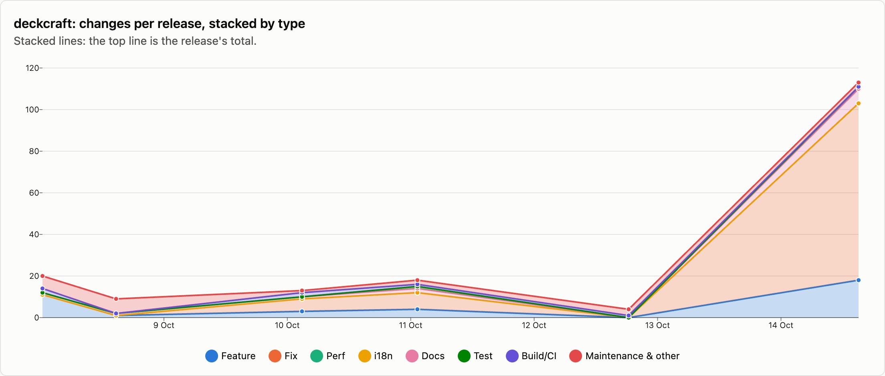
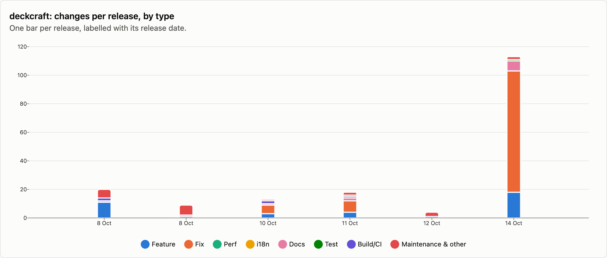
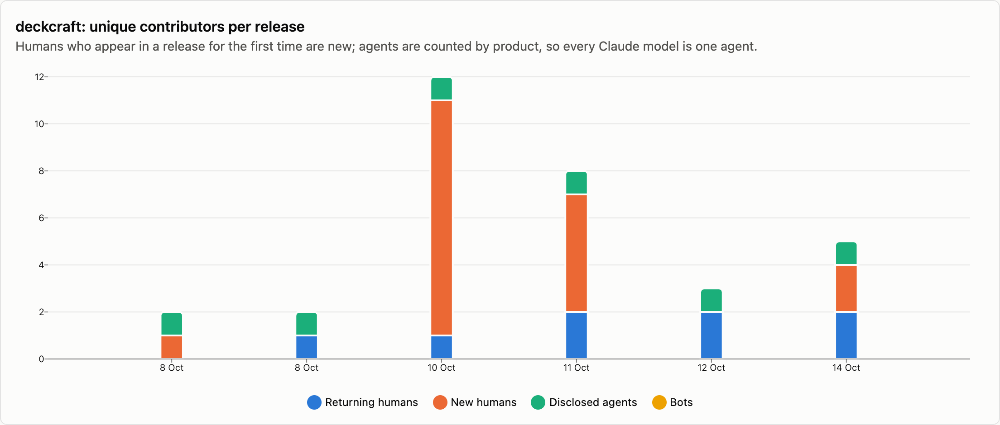
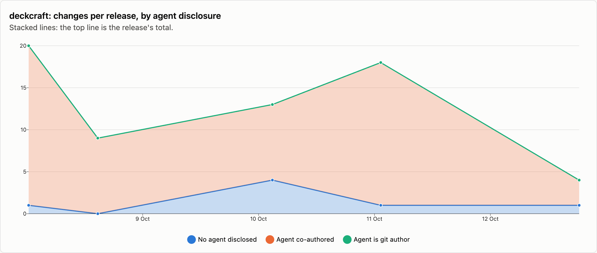

# deckcraft — changes per release

6 releases, 2026-10-08 → 2026-10-14. Each release is counted as the changes that landed between the previous release tag and its own; the first one is everything up to the first tag. See [../README.md](../README.md) for how changes are counted and categorised. The charts cover released changes; the commentary under them is generated from the same numbers.

## Changes by type

<picture>
  <source media="(prefers-color-scheme: dark)" srcset="../charts/dark/deckcraft-changes-line.png">
  
</picture>

<picture>
  <source media="(prefers-color-scheme: dark)" srcset="../charts/dark/deckcraft-changes-bar.png">
  
</picture>

**What this shows**

- deckcraft has had 6 releases with 177 changes in total, over 6 days.
- The biggest release was v0.7.0 (14 Oct) with 113 changes, which is 64% of everything released so far.
- Releases are getting bigger: the first 3 releases averaged 14 changes each and the last 3 releases averaged 45.
- Overall, fixes make up 56% of changes and features 21%.
- The work has shifted from building new things to fixing: features went from 36% of changes in the first 3 releases to 16% in the last 3 releases, and fixes from 14% to 69%.
- No change was labelled as performance work.
- After features and fixes, the next biggest group is release housekeeping at 8%.
- Since the last release, 373 more changes have landed on main and not been released yet: 123 features and 152 fixes among them.

| Release | Published | Changes | Feature | Fix | Perf | i18n | Docs | Test | Build/CI | Release | Refactor | Deps | Security | Revert | Other |
|---|--:|--:|--:|--:|--:|--:|--:|--:|--:|--:|--:|--:|--:|--:|--:|
| [v0.1.0](https://github.com/storytold/deckcraft/releases/tag/v0.1.0) | 2026-10-08 | 20 | 11 | · | · | · | 1 | · | 2 | 2 | 2 | 1 | · | · | 1 |
| [v0.3.0](https://github.com/storytold/deckcraft/releases/tag/v0.3.0) | 2026-10-08 | 9 | 1 | · | · | · | 1 | · | · | 6 | 1 | · | · | · | · |
| [v0.4.0](https://github.com/storytold/deckcraft/releases/tag/v0.4.0) | 2026-10-10 | 13 | 3 | 6 | · | · | 1 | · | 2 | 1 | · | · | · | · | · |
| [v0.5.0](https://github.com/storytold/deckcraft/releases/tag/v0.5.0) | 2026-10-11 | 18 | 4 | 8 | · | · | 2 | 1 | 1 | 1 | 1 | · | · | · | · |
| [v0.6.1](https://github.com/storytold/deckcraft/releases/tag/v0.6.1) | 2026-10-12 | 4 | · | · | · | · | · | · | 1 | 3 | · | · | · | · | · |
| [v0.7.0](https://github.com/storytold/deckcraft/releases/tag/v0.7.0) | 2026-10-14 | 113 | 18 | 85 | · | · | 7 | 1 | · | 1 | 1 | · | · | · | · |
| _unreleased (main)_ | 2026-10-15 | 373 | 123 | 152 | 6 | · | 2 | 5 | 4 | · | 67 | · | 13 | · | 1 |
| **Released total** |  | **177** | **37** | **99** | · | · | **12** | **2** | **6** | **14** | **5** | **1** | · | · | **1** |

Share of released changes: feature 21%, fix 56%, docs 7%, test 1%, build/ci 3%, release 8%, refactor 3%, deps 1%, other 1%.

## How changes landed

**What this shows**

- 49% of changes came in through pull requests; the rest were committed directly.
- Of the 86 pull requests, 33% came from people outside the core team.
- Outside contributions have gone down: 69% of pull requests in the first 3 releases, 24% in the last 3 releases.

| Release | Commits | PR merges | Squash merges | Direct commits | Batch commits | Commits inside PRs | Sync merges | Community PRs | Team PRs |
|---|--:|--:|--:|--:|--:|--:|--:|--:|--:|
| [v0.1.0](https://github.com/storytold/deckcraft/releases/tag/v0.1.0) | 20 | · | · | 20 | · | · | · | · | · |
| [v0.3.0](https://github.com/storytold/deckcraft/releases/tag/v0.3.0) | 9 | · | 4 | 5 | · | · | · | · | 4 |
| [v0.4.0](https://github.com/storytold/deckcraft/releases/tag/v0.4.0) | 14 | 1 | 11 | 1 | · | 1 | · | 11 | 1 |
| [v0.5.0](https://github.com/storytold/deckcraft/releases/tag/v0.5.0) | 18 | · | 18 | · | · | · | · | 16 | 2 |
| [v0.6.1](https://github.com/storytold/deckcraft/releases/tag/v0.6.1) | 4 | · | 2 | 2 | · | · | · | 1 | 1 |
| [v0.7.0](https://github.com/storytold/deckcraft/releases/tag/v0.7.0) | 113 | · | 50 | 63 | · | · | · | · | 50 |
| _unreleased (main)_ | 721 | 298 | 4 | 70 | 1 | 327 | 21 | 302 | · |
| **Released total** | **178** | **1** | **85** | **91** | **0** | **1** | **0** | **28** | **58** |

Changes = PR merges + squash merges + direct commits + batch commits. Commits = changes + commits inside PRs + sync merges.

## Contributors

<picture>
  <source media="(prefers-color-scheme: dark)" srcset="../charts/dark/deckcraft-contributors.png">
  
</picture>

<picture>
  <source media="(prefers-color-scheme: dark)" srcset="../charts/dark/deckcraft-agent-disclosure.png">
  
</picture>

**What this shows**

- 18 people have contributed to released changes.
- The first release had 1 person and the latest had 4; the most in one release was 11, in v0.4.0 (10 Oct).
- In the latest release, 2 of the 4 people were contributing for the first time.
- The most active person, @echelon, authored 81% of all changes, and the three most active authored 89% between them.
- 92% of changes say an AI agent was involved (162 of 177).
- That share has stayed about the same over time (88% in the first 3 releases, 93% in the last 3 releases).
- Claude accounts for all of the changes that name an agent.
- These figures only count changes that say so, so the real share may be higher.

| Release | Humans | New | Changes disclosing an agent | Share | Agent is git author | Agents disclosed | Bots |
|---|--:|--:|--:|--:|--:|---|--:|
| [v0.1.0](https://github.com/storytold/deckcraft/releases/tag/v0.1.0) | 1 | 1 | 19 | 95% | · | Claude | · |
| [v0.3.0](https://github.com/storytold/deckcraft/releases/tag/v0.3.0) | 1 | · | 9 | 100% | · | Claude | · |
| [v0.4.0](https://github.com/storytold/deckcraft/releases/tag/v0.4.0) | 11 | 10 | 9 | 69% | · | Claude | · |
| [v0.5.0](https://github.com/storytold/deckcraft/releases/tag/v0.5.0) | 7 | 5 | 17 | 94% | · | Claude | · |
| [v0.6.1](https://github.com/storytold/deckcraft/releases/tag/v0.6.1) | 2 | · | 3 | 75% | · | Claude | · |
| [v0.7.0](https://github.com/storytold/deckcraft/releases/tag/v0.7.0) | 4 | 2 | 105 | 93% | · | Claude | · |
| _unreleased (main)_ | 36 | 28 | 234 | 63% | 1 | Cursor, Claude | · |
| **Released total** | **18** |  | **162** | 92% | **0** | Claude | · |

Humans are unique people per release, authors and co-authors together; New is how many of them had not appeared in an earlier release of this repo. The total row counts each person once. An agent is disclosed when it is a commit's git author, is named in a `Co-authored-by` trailer, or the message says it was generated with one.

Most active humans in released changes: @echelon (157), @alexanderalber (9), @LloydNicholson (5), @MarekSpodBiedry (3), @Silvertree2010 (3), @dylanmtaylor (2), @switch87 (2), @xmaks82 (2), @DimaSmaha (1), @DWAA1660 (1).
