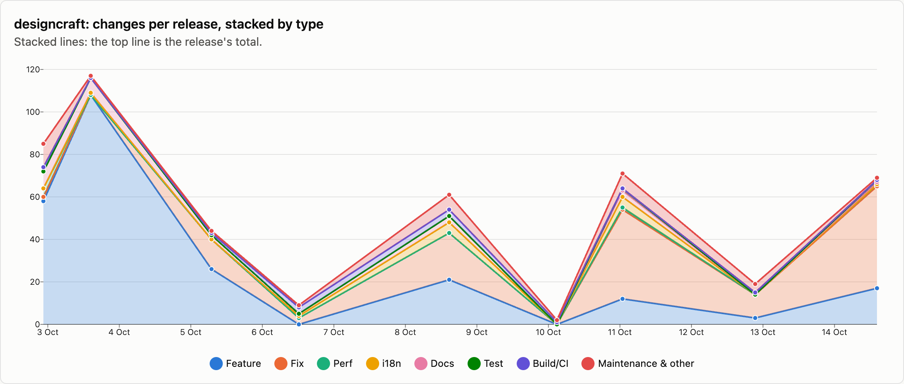
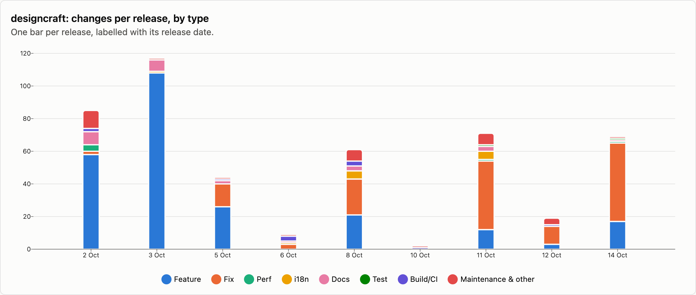
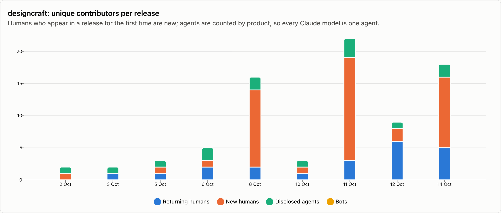
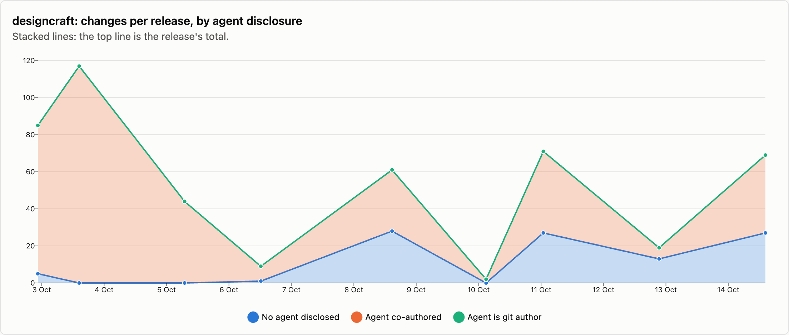

# designcraft — changes per release

9 releases, 2026-10-02 → 2026-10-14. Each release is counted as the changes that landed between the previous release tag and its own; the first one is everything up to the first tag. See [../README.md](../README.md) for how changes are counted and categorised. The charts cover released changes; the commentary under them is generated from the same numbers.

## Changes by type

<picture>
  <source media="(prefers-color-scheme: dark)" srcset="../charts/dark/designcraft-changes-line.png">
  
</picture>

<picture>
  <source media="(prefers-color-scheme: dark)" srcset="../charts/dark/designcraft-changes-bar.png">
  
</picture>

**What this shows**

- designcraft has had 9 releases with 477 changes in total, over 12 days.
- The biggest release was v0.1.1 (3 Oct) with 117 changes, which is 25% of everything released so far.
- Releases are getting smaller: the first 4 releases averaged 64 changes each and the last 4 releases averaged 40.
- Overall, features make up 51% of changes and fixes 30%.
- The work has shifted from building new things to fixing: features went from 75% of changes in the first 4 releases to 20% in the last 4 releases, and fixes from 7% to 63%.
- Performance work is rare: 6 changes.
- After features and fixes, the next biggest group is documentation at 5%.
- Since the last release, 973 more changes have landed on main and not been released yet: 231 features and 460 fixes among them.

| Release | Published | Changes | Feature | Fix | Perf | i18n | Docs | Test | Build/CI | Release | Refactor | Deps | Security | Revert | Other |
|---|--:|--:|--:|--:|--:|--:|--:|--:|--:|--:|--:|--:|--:|--:|--:|
| [v0.1.0](https://github.com/storytold/designcraft/releases/tag/v0.1.0) | 2026-10-02 | 85 | 58 | 2 | 4 | · | 8 | · | 2 | · | 7 | · | · | · | 4 |
| [v0.1.1](https://github.com/storytold/designcraft/releases/tag/v0.1.1) | 2026-10-03 | 117 | 108 | · | · | 1 | 7 | · | · | 1 | · | · | · | · | · |
| [v0.2.0](https://github.com/storytold/designcraft/releases/tag/v0.2.0) | 2026-10-05 | 44 | 26 | 14 | · | · | 2 | · | 1 | 1 | · | · | · | · | · |
| [v0.2.1](https://github.com/storytold/designcraft/releases/tag/v0.2.1) | 2026-10-06 | 9 | · | 3 | · | 1 | 1 | · | 3 | 1 | · | · | · | · | · |
| [v0.4.0](https://github.com/storytold/designcraft/releases/tag/v0.4.0) | 2026-10-08 | 61 | 21 | 22 | · | 5 | 3 | · | 3 | 5 | 2 | · | · | · | · |
| [v0.5.0](https://github.com/storytold/designcraft/releases/tag/v0.5.0) | 2026-10-10 | 2 | · | · | · | · | · | · | 1 | 1 | · | · | · | · | · |
| [v0.6.0](https://github.com/storytold/designcraft/releases/tag/v0.6.0) | 2026-10-11 | 71 | 12 | 42 | 1 | 5 | 3 | 1 | · | 1 | 2 | · | 4 | · | · |
| [v0.7.1](https://github.com/storytold/designcraft/releases/tag/v0.7.1) | 2026-10-12 | 19 | 3 | 11 | · | · | · | · | 1 | 3 | 1 | · | · | · | · |
| [v0.8.0](https://github.com/storytold/designcraft/releases/tag/v0.8.0) | 2026-10-14 | 69 | 17 | 48 | 1 | · | 1 | 1 | · | 1 | · | · | · | · | · |
| _unreleased (main)_ | 2026-10-16 | 973 | 231 | 460 | 11 | 60 | 55 | 63 | 9 | 1 | 50 | 10 | 17 | 5 | 1 |
| **Released total** |  | **477** | **245** | **142** | **6** | **12** | **25** | **2** | **11** | **14** | **12** | · | **4** | · | **4** |

Share of released changes: feature 51%, fix 30%, perf 1%, i18n 3%, docs 5%, build/ci 2%, release 3%, refactor 3%, security 1%, other 1%.

## How changes landed

**What this shows**

- 36% of changes came in through pull requests; the rest were committed directly.
- That has grown: pull requests were 9% of changes in the first 4 releases and 71% in the last 4 releases.
- Of the 172 pull requests, 82% came from people outside the core team.
- Outside contributions have gone up: 21% of pull requests in the first 4 releases, 95% in the last 4 releases.

| Release | Commits | PR merges | Squash merges | Direct commits | Batch commits | Commits inside PRs | Sync merges | Community PRs | Team PRs |
|---|--:|--:|--:|--:|--:|--:|--:|--:|--:|
| [v0.1.0](https://github.com/storytold/designcraft/releases/tag/v0.1.0) | 95 | · | · | 85 | · | · | 10 | · | · |
| [v0.1.1](https://github.com/storytold/designcraft/releases/tag/v0.1.1) | 117 | · | · | 117 | · | · | · | · | · |
| [v0.2.0](https://github.com/storytold/designcraft/releases/tag/v0.2.0) | 55 | 11 | 6 | 27 | · | 11 | · | 3 | 14 |
| [v0.2.1](https://github.com/storytold/designcraft/releases/tag/v0.2.1) | 14 | 4 | 3 | 2 | · | 5 | · | 2 | 5 |
| [v0.4.0](https://github.com/storytold/designcraft/releases/tag/v0.4.0) | 117 | 19 | 15 | 27 | · | 51 | 5 | 28 | 6 |
| [v0.5.0](https://github.com/storytold/designcraft/releases/tag/v0.5.0) | 3 | 1 | · | 1 | · | 1 | · | 1 | · |
| [v0.6.0](https://github.com/storytold/designcraft/releases/tag/v0.6.0) | 71 | · | 71 | · | · | · | · | 66 | 5 |
| [v0.7.1](https://github.com/storytold/designcraft/releases/tag/v0.7.1) | 25 | 2 | 15 | 2 | · | 5 | 1 | 16 | 1 |
| [v0.8.0](https://github.com/storytold/designcraft/releases/tag/v0.8.0) | 113 | 11 | 14 | 44 | · | 11 | 33 | 25 | · |
| _unreleased (main)_ | 1978 | 248 | 5 | 10 | 710 | 401 | 604 | 253 | · |
| **Released total** | **610** | **48** | **124** | **305** | **0** | **84** | **49** | **141** | **31** |

Changes = PR merges + squash merges + direct commits + batch commits. Commits = changes + commits inside PRs + sync merges.

## Contributors

<picture>
  <source media="(prefers-color-scheme: dark)" srcset="../charts/dark/designcraft-contributors.png">
  
</picture>

<picture>
  <source media="(prefers-color-scheme: dark)" srcset="../charts/dark/designcraft-agent-disclosure.png">
  
</picture>

**What this shows**

- 45 people have contributed to released changes.
- The first release had 1 person and the latest had 16; the most in one release was 19, in v0.6.0 (11 Oct).
- In the latest release, 11 of the 16 people were contributing for the first time.
- The most active person, @echelon, authored 56% of all changes, and the three most active authored 69% between them.
- 79% of changes say an AI agent was involved (376 of 477).
- That share has gone down: 98% in the first 4 releases and 58% in the last 4 releases.
- Claude accounts for nearly all of the changes that name an agent; 2 other agents are named on 18 changes between them.
- These figures only count changes that say so, so the real share may be higher.

| Release | Humans | New | Changes disclosing an agent | Share | Agent is git author | Agents disclosed | Bots |
|---|--:|--:|--:|--:|--:|---|--:|
| [v0.1.0](https://github.com/storytold/designcraft/releases/tag/v0.1.0) | 1 | 1 | 80 | 94% | · | Claude | · |
| [v0.1.1](https://github.com/storytold/designcraft/releases/tag/v0.1.1) | 1 | · | 117 | 100% | · | Claude | · |
| [v0.2.0](https://github.com/storytold/designcraft/releases/tag/v0.2.0) | 2 | 1 | 44 | 100% | · | Claude | · |
| [v0.2.1](https://github.com/storytold/designcraft/releases/tag/v0.2.1) | 3 | 1 | 8 | 89% | · | Claude, OpenAI Codex / ChatGPT | · |
| [v0.4.0](https://github.com/storytold/designcraft/releases/tag/v0.4.0) | 14 | 12 | 33 | 54% | · | Claude, OpenAI Codex / ChatGPT | · |
| [v0.5.0](https://github.com/storytold/designcraft/releases/tag/v0.5.0) | 2 | 1 | 2 | 100% | · | Claude | · |
| [v0.6.0](https://github.com/storytold/designcraft/releases/tag/v0.6.0) | 19 | 16 | 44 | 62% | · | Claude, Codebuff, OpenAI Codex / ChatGPT | · |
| [v0.7.1](https://github.com/storytold/designcraft/releases/tag/v0.7.1) | 8 | 2 | 6 | 32% | · | Claude | · |
| [v0.8.0](https://github.com/storytold/designcraft/releases/tag/v0.8.0) | 16 | 11 | 42 | 61% | · | Claude, OpenAI Codex / ChatGPT | · |
| _unreleased (main)_ | 80 | 52 | 282 | 29% | 1 | Claude, OpenAI Codex / ChatGPT, Codebuff, GitHub Copilot | · |
| **Released total** | **45** |  | **376** | 79% | **0** | Claude, OpenAI Codex / ChatGPT, Codebuff | · |

Humans are unique people per release, authors and co-authors together; New is how many of them had not appeared in an earlier release of this repo. The total row counts each person once. An agent is disclosed when it is a commit's git author, is named in a `Co-authored-by` trailer, or the message says it was generated with one.

Most active humans in released changes: @echelon (334), @aiongg (36), @skylartaylor (30), @moppeeer (29), @CameronGilroy (20), @japbcoelho (15), @sanyamsingh001 (11), @jahala (8), @storybored379 (6), @marcoarnulfo (5).
