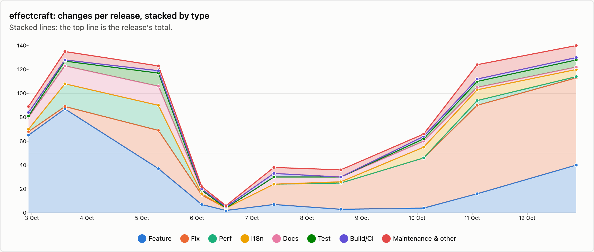
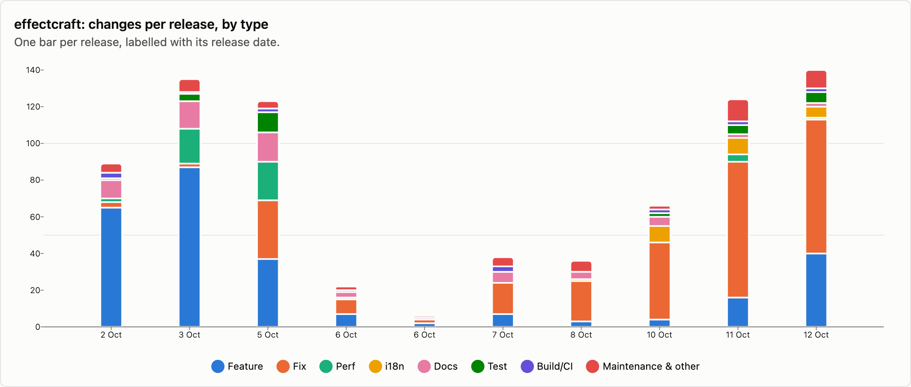
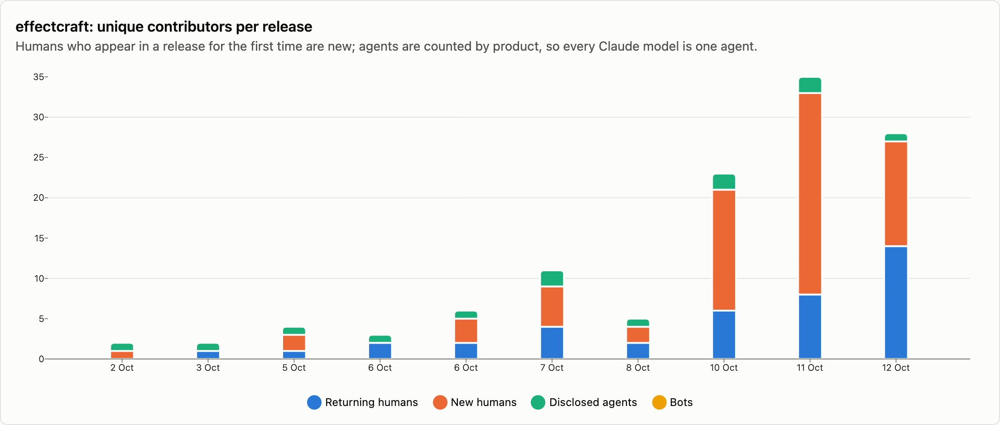
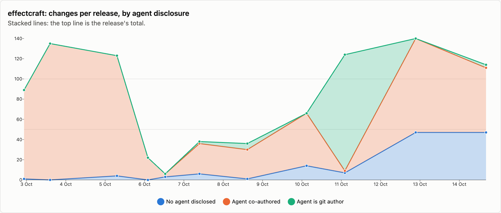

# effectcraft — changes per release

11 releases, 2026-10-02 → 2026-10-14. Each release is counted as the changes that landed between the previous release tag and its own; the first one is everything up to the first tag. See [../README.md](../README.md) for how changes are counted and categorised. The charts cover released changes; the commentary under them is generated from the same numbers.

## Changes by type

<picture>
  <source media="(prefers-color-scheme: dark)" srcset="../charts/dark/effectcraft-changes-line.png">
  
</picture>

<picture>
  <source media="(prefers-color-scheme: dark)" srcset="../charts/dark/effectcraft-changes-bar.png">
  
</picture>

**What this shows**

- effectcraft has had 11 releases with 893 changes in total, over 12 days.
- The biggest release was v0.9.2 (12 Oct) with 140 changes, which is 16% of everything released so far.
- Release size has stayed fairly steady: the first 5 releases averaged 75 changes each and the last 5 releases averaged 96.
- Overall, fixes make up 39% of changes and features 32%.
- The work has shifted from building new things to fixing: features went from 53% of changes in the first 5 releases to 18% in the last 5 releases, and fixes from 13% to 59%.
- Performance work is 6% of changes (52), most of it in v0.2.0 (5 Oct), which had 21.
- After features and fixes, the next biggest group is documentation at 7%.
- Since the last release, 79 more changes have landed on main and not been released yet: 3 features and 59 fixes among them.

| Release | Published | Changes | Feature | Fix | Perf | i18n | Docs | Test | Build/CI | Release | Refactor | Deps | Security | Revert | Other |
|---|--:|--:|--:|--:|--:|--:|--:|--:|--:|--:|--:|--:|--:|--:|--:|
| [v0.1.0](https://github.com/storytold/effectcraft/releases/tag/v0.1.0) | 2026-10-02 | 89 | 65 | 3 | 2 | · | 10 | 1 | 3 | 1 | 2 | 1 | · | · | 1 |
| [v0.1.1](https://github.com/storytold/effectcraft/releases/tag/v0.1.1) | 2026-10-03 | 135 | 87 | 2 | 19 | · | 15 | 4 | 1 | 1 | 6 | · | · | · | · |
| [v0.2.0](https://github.com/storytold/effectcraft/releases/tag/v0.2.0) | 2026-10-05 | 123 | 37 | 32 | 21 | · | 16 | 11 | 2 | 1 | 1 | · | 2 | · | · |
| [v0.3.0](https://github.com/storytold/effectcraft/releases/tag/v0.3.0) | 2026-10-06 | 22 | 7 | 8 | 1 | · | 3 | · | 1 | 2 | · | · | · | · | · |
| [v0.3.1](https://github.com/storytold/effectcraft/releases/tag/v0.3.1) | 2026-10-06 | 6 | 2 | 2 | · | · | · | · | 1 | 1 | · | · | · | · | · |
| [v0.4.0](https://github.com/storytold/effectcraft/releases/tag/v0.4.0) | 2026-10-07 | 38 | 7 | 17 | · | · | 6 | · | 3 | 1 | 2 | · | · | · | 2 |
| [v0.6.0](https://github.com/storytold/effectcraft/releases/tag/v0.6.0) | 2026-10-08 | 36 | 3 | 22 | · | 1 | 4 | · | · | 5 | 1 | · | · | · | · |
| [v0.7.0](https://github.com/storytold/effectcraft/releases/tag/v0.7.0) | 2026-10-10 | 66 | 4 | 42 | · | 9 | 5 | 2 | 2 | 1 | · | · | · | 1 | · |
| [v0.8.0](https://github.com/storytold/effectcraft/releases/tag/v0.8.0) | 2026-10-11 | 124 | 16 | 74 | 4 | 9 | 2 | 5 | 2 | 1 | 4 | 1 | · | · | 6 |
| [v0.9.2](https://github.com/storytold/effectcraft/releases/tag/v0.9.2) | 2026-10-12 | 140 | 40 | 73 | 1 | 6 | 2 | 6 | 2 | 4 | 3 | · | 3 | · | · |
| [v0.10.0](https://github.com/storytold/effectcraft/releases/tag/v0.10.0) | 2026-10-14 | 114 | 22 | 70 | 4 | 6 | 2 | 3 | · | 1 | 6 | · | · | · | · |
| _unreleased (main)_ | 2026-10-17 | 79 | 3 | 59 | 5 | 3 | 3 | 1 | 4 | · | 1 | · | · | · | · |
| **Released total** |  | **893** | **290** | **345** | **52** | **31** | **65** | **32** | **17** | **19** | **25** | **2** | **5** | **1** | **9** |

Share of released changes: feature 32%, fix 39%, perf 6%, i18n 3%, docs 7%, test 4%, build/ci 2%, release 2%, refactor 3%, security 1%, other 1%.

## How changes landed

**What this shows**

- 57% of changes came in through pull requests; the rest were committed directly.
- That has grown: 19% of changes came in through pull requests in the first 5 releases and 84% in the last 5 releases.
- Of the 506 pull requests, 69% came from people outside the core team.
- Outside contributions have gone up: 11% of pull requests in the first 5 releases, 82% in the last 5 releases.

| Release | Commits | PR merges | Squash merges | Direct commits | Batch commits | Commits inside PRs | Sync merges | Community PRs | Team PRs |
|---|--:|--:|--:|--:|--:|--:|--:|--:|--:|
| [v0.1.0](https://github.com/storytold/effectcraft/releases/tag/v0.1.0) | 119 | · | · | 89 | · | · | 30 | · | · |
| [v0.1.1](https://github.com/storytold/effectcraft/releases/tag/v0.1.1) | 217 | · | · | 135 | · | · | 82 | · | · |
| [v0.2.0](https://github.com/storytold/effectcraft/releases/tag/v0.2.0) | 250 | 44 | · | 79 | · | 81 | 46 | 5 | 39 |
| [v0.3.0](https://github.com/storytold/effectcraft/releases/tag/v0.3.0) | 45 | 20 | 1 | 1 | · | 22 | 1 | · | 21 |
| [v0.3.1](https://github.com/storytold/effectcraft/releases/tag/v0.3.1) | 13 | 6 | · | · | · | 6 | 1 | 3 | 3 |
| [v0.4.0](https://github.com/storytold/effectcraft/releases/tag/v0.4.0) | 96 | 31 | · | 7 | · | 56 | 2 | 8 | 23 |
| [v0.6.0](https://github.com/storytold/effectcraft/releases/tag/v0.6.0) | 92 | 28 | 4 | 4 | · | 56 | · | 1 | 31 |
| [v0.7.0](https://github.com/storytold/effectcraft/releases/tag/v0.7.0) | 170 | 52 | · | 14 | · | 102 | 2 | 28 | 24 |
| [v0.8.0](https://github.com/storytold/effectcraft/releases/tag/v0.8.0) | 300 | 93 | 2 | · | 29 | 166 | 10 | 82 | 13 |
| [v0.9.2](https://github.com/storytold/effectcraft/releases/tag/v0.9.2) | 284 | 122 | 1 | 17 | · | 141 | 3 | 119 | 4 |
| [v0.10.0](https://github.com/storytold/effectcraft/releases/tag/v0.10.0) | 285 | 101 | 1 | 12 | · | 169 | 2 | 102 | · |
| _unreleased (main)_ | 178 | 73 | 6 | · | · | 91 | 8 | 76 | 3 |
| **Released total** | **1871** | **497** | **9** | **358** | **29** | **799** | **179** | **348** | **158** |

Changes = PR merges + squash merges + direct commits + batch commits. Commits = changes + commits inside PRs + sync merges.

## Contributors

<picture>
  <source media="(prefers-color-scheme: dark)" srcset="../charts/dark/effectcraft-contributors.png">
  
</picture>

<picture>
  <source media="(prefers-color-scheme: dark)" srcset="../charts/dark/effectcraft-agent-disclosure.png">
  
</picture>

**What this shows**

- 80 people have contributed to released changes.
- The first release had 1 person and the latest had 27; the most in one release was 33, in v0.8.0 (11 Oct).
- In the latest release, 14 of the 27 people were contributing for the first time.
- The most active person, @echelon, authored 44% of all changes, and the three most active authored 64% between them.
- 85% of changes say an AI agent was involved (763 of 893).
- That share has gone down: 98% in the first 5 releases and 76% in the last 5 releases.
- Claude accounts for nearly all of the changes that name an agent; OpenAI Codex / ChatGPT is named on 15 changes.
- In 126 changes the agent is the commit author itself, not only a co-author.
- These figures only count changes that say so, so the real share may be higher.

| Release | Humans | New | Changes disclosing an agent | Share | Agent is git author | Agents disclosed | Bots |
|---|--:|--:|--:|--:|--:|---|--:|
| [v0.1.0](https://github.com/storytold/effectcraft/releases/tag/v0.1.0) | 1 | 1 | 88 | 99% | · | Claude | · |
| [v0.1.1](https://github.com/storytold/effectcraft/releases/tag/v0.1.1) | 1 | · | 135 | 100% | · | Claude | · |
| [v0.2.0](https://github.com/storytold/effectcraft/releases/tag/v0.2.0) | 3 | 2 | 119 | 97% | · | Claude | · |
| [v0.3.0](https://github.com/storytold/effectcraft/releases/tag/v0.3.0) | 2 | · | 22 | 100% | · | Claude | · |
| [v0.3.1](https://github.com/storytold/effectcraft/releases/tag/v0.3.1) | 5 | 3 | 3 | 50% | · | Claude | · |
| [v0.4.0](https://github.com/storytold/effectcraft/releases/tag/v0.4.0) | 9 | 5 | 32 | 84% | 2 | Claude, OpenAI Codex / ChatGPT | · |
| [v0.6.0](https://github.com/storytold/effectcraft/releases/tag/v0.6.0) | 4 | 2 | 35 | 97% | 6 | Claude | · |
| [v0.7.0](https://github.com/storytold/effectcraft/releases/tag/v0.7.0) | 21 | 15 | 52 | 79% | · | Claude, OpenAI Codex / ChatGPT | · |
| [v0.8.0](https://github.com/storytold/effectcraft/releases/tag/v0.8.0) | 33 | 25 | 117 | 94% | 115 | Claude, OpenAI Codex / ChatGPT | · |
| [v0.9.2](https://github.com/storytold/effectcraft/releases/tag/v0.9.2) | 27 | 13 | 93 | 66% | · | Claude | · |
| [v0.10.0](https://github.com/storytold/effectcraft/releases/tag/v0.10.0) | 27 | 14 | 67 | 59% | 3 | Claude, OpenAI Codex / ChatGPT | · |
| _unreleased (main)_ | 30 | 11 | 37 | 47% | · | Claude, OpenAI Codex / ChatGPT, DeepSeek | · |
| **Released total** | **80** |  | **763** | 85% | **126** | Claude, OpenAI Codex / ChatGPT | · |

Humans are unique people per release, authors and co-authors together; New is how many of them had not appeared in an earlier release of this repo. The total row counts each person once. An agent is disclosed when it is a commit's git author, is named in a `Co-authored-by` trailer, or the message says it was generated with one.

Most active humans in released changes: @echelon (643), @bflatastic (135), @vangel76 (62), @pravdomil (29), @Ni-zav (25), @MarekSpodBiedry (23), @vbasky (23), @nanox333 (19), @marcoarnulfo (12), @tylerjenningsw (12).
