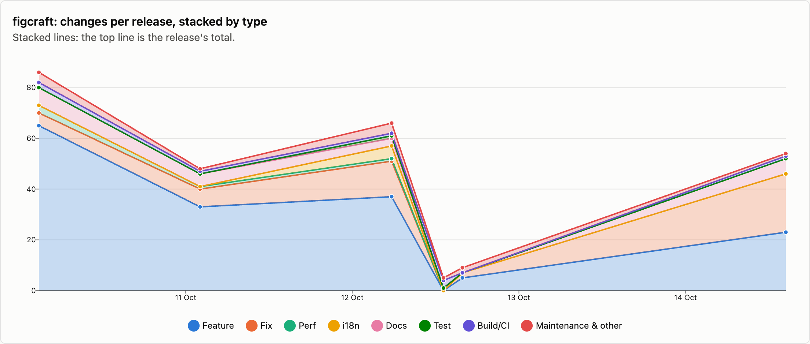
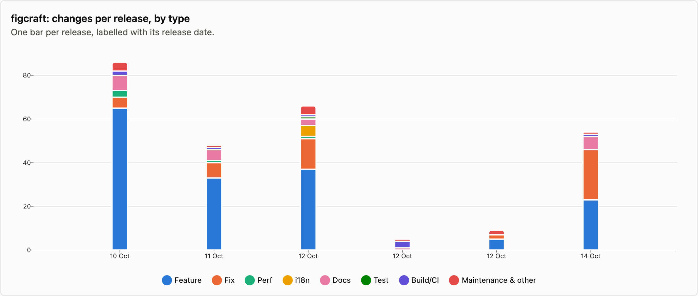
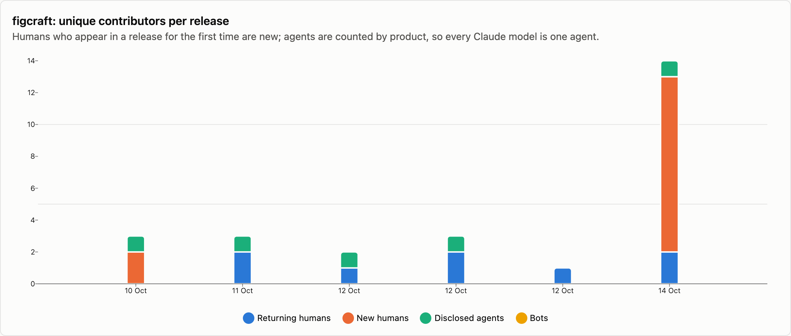
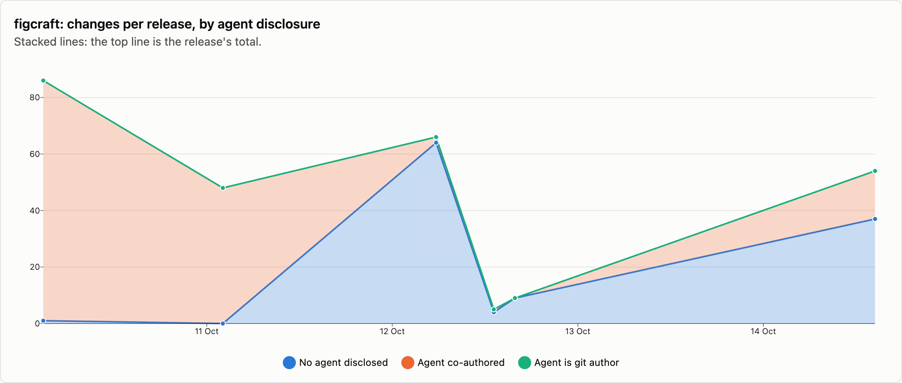

# figcraft — changes per release

6 releases, 2026-10-10 → 2026-10-14. Each release is counted as the changes that landed between the previous release tag and its own; the first one is everything up to the first tag. See [../README.md](../README.md) for how changes are counted and categorised. The charts cover released changes; the commentary under them is generated from the same numbers.

## Changes by type

<picture>
  <source media="(prefers-color-scheme: dark)" srcset="../charts/dark/figcraft-changes-line.png">
  
</picture>

<picture>
  <source media="(prefers-color-scheme: dark)" srcset="../charts/dark/figcraft-changes-bar.png">
  
</picture>

**What this shows**

- figcraft has had 6 releases with 268 changes in total, over 4 days.
- The biggest release was v0.2.0 (10 Oct) with 86 changes, which is 32% of everything released so far.
- Releases are getting smaller: the first 3 releases averaged 67 changes each and the last 3 releases averaged 23.
- Overall, features make up 61% of changes and fixes 19%.
- The work has shifted from building new things to fixing: features went from 68% of changes in the first 3 releases to 41% in the last 3 releases, and fixes from 13% to 37%.
- Performance work is rare: 5 changes.
- After features and fixes, the next biggest group is documentation at 8%.
- Since the last release, 156 more changes have landed on main and not been released yet: 16 features and 77 fixes among them.

| Release | Published | Changes | Feature | Fix | Perf | i18n | Docs | Test | Build/CI | Release | Refactor | Deps | Security | Revert | Other |
|---|--:|--:|--:|--:|--:|--:|--:|--:|--:|--:|--:|--:|--:|--:|--:|
| [v0.2.0](https://github.com/storytold/figcraft/releases/tag/v0.2.0) | 2026-10-10 | 86 | 65 | 5 | 3 | · | 7 | · | 2 | 1 | 2 | · | · | · | 1 |
| [v0.3.1](https://github.com/storytold/figcraft/releases/tag/v0.3.1) | 2026-10-11 | 48 | 33 | 7 | 1 | · | 5 | · | 1 | 1 | · | · | · | · | · |
| [v0.4.0](https://github.com/storytold/figcraft/releases/tag/v0.4.0) | 2026-10-12 | 66 | 37 | 14 | 1 | 5 | 3 | 1 | 1 | 1 | · | · | 3 | · | · |
| [v0.5.0](https://github.com/storytold/figcraft/releases/tag/v0.5.0) | 2026-10-12 | 5 | · | · | · | · | 1 | · | 3 | 1 | · | · | · | · | · |
| [v0.5.1](https://github.com/storytold/figcraft/releases/tag/v0.5.1) | 2026-10-12 | 9 | 5 | 2 | · | · | · | · | · | 2 | · | · | · | · | · |
| [v0.6.0](https://github.com/storytold/figcraft/releases/tag/v0.6.0) | 2026-10-14 | 54 | 23 | 23 | · | · | 6 | · | 1 | 1 | · | · | · | · | · |
| _unreleased (main)_ | 2026-10-17 | 156 | 16 | 77 | 7 | 14 | 14 | 7 | 7 | · | 2 | · | 8 | · | 4 |
| **Released total** |  | **268** | **163** | **51** | **5** | **5** | **22** | **1** | **8** | **7** | **2** | · | **3** | · | **1** |

Share of released changes: feature 61%, fix 19%, perf 2%, i18n 2%, docs 8%, build/ci 3%, release 3%, refactor 1%, security 1%.

## How changes landed

**What this shows**

- 73% of changes came in through pull requests; the rest were committed directly.
- Of the 196 pull requests, 13% came from people outside the core team.
- Outside contributions have gone up: 0% of pull requests in the first 3 releases, 56% in the last 3 releases.

| Release | Commits | PR merges | Squash merges | Direct commits | Batch commits | Commits inside PRs | Sync merges | Community PRs | Team PRs |
|---|--:|--:|--:|--:|--:|--:|--:|--:|--:|
| [v0.2.0](https://github.com/storytold/figcraft/releases/tag/v0.2.0) | 86 | · | 59 | 27 | · | · | · | · | 59 |
| [v0.3.1](https://github.com/storytold/figcraft/releases/tag/v0.3.1) | 48 | · | 48 | · | · | · | · | · | 48 |
| [v0.4.0](https://github.com/storytold/figcraft/releases/tag/v0.4.0) | 66 | · | 44 | 22 | · | · | · | · | 44 |
| [v0.5.0](https://github.com/storytold/figcraft/releases/tag/v0.5.0) | 5 | · | 4 | 1 | · | · | · | · | 4 |
| [v0.5.1](https://github.com/storytold/figcraft/releases/tag/v0.5.1) | 9 | · | 5 | 4 | · | · | · | · | 5 |
| [v0.6.0](https://github.com/storytold/figcraft/releases/tag/v0.6.0) | 54 | · | 36 | 18 | · | · | · | 25 | 11 |
| _unreleased (main)_ | 765 | 14 | 14 | 128 | · | 244 | 365 | 7 | 21 |
| **Released total** | **268** | **0** | **196** | **72** | **0** | **0** | **0** | **25** | **171** |

Changes = PR merges + squash merges + direct commits + batch commits. Commits = changes + commits inside PRs + sync merges.

## Contributors

<picture>
  <source media="(prefers-color-scheme: dark)" srcset="../charts/dark/figcraft-contributors.png">
  
</picture>

<picture>
  <source media="(prefers-color-scheme: dark)" srcset="../charts/dark/figcraft-agent-disclosure.png">
  
</picture>

**What this shows**

- 13 people have contributed to released changes.
- The first release had 2 people and the latest had 13.
- In the latest release, 11 of the 13 people were contributing for the first time.
- The most active person, @bflatastic, authored 78% of all changes, and the three most active authored 93% between them.
- 57% of changes say an AI agent was involved (153 of 268).
- That share has gone down: 68% in the first 3 releases and 26% in the last 3 releases.
- Claude accounts for all of the changes that name an agent.
- These figures only count changes that say so, so the real share may be higher.

| Release | Humans | New | Changes disclosing an agent | Share | Agent is git author | Agents disclosed | Bots |
|---|--:|--:|--:|--:|--:|---|--:|
| [v0.2.0](https://github.com/storytold/figcraft/releases/tag/v0.2.0) | 2 | 2 | 85 | 99% | · | Claude | · |
| [v0.3.1](https://github.com/storytold/figcraft/releases/tag/v0.3.1) | 2 | · | 48 | 100% | · | Claude | · |
| [v0.4.0](https://github.com/storytold/figcraft/releases/tag/v0.4.0) | 1 | · | 2 | 3% | · | Claude | · |
| [v0.5.0](https://github.com/storytold/figcraft/releases/tag/v0.5.0) | 2 | · | 1 | 20% | · | Claude | · |
| [v0.5.1](https://github.com/storytold/figcraft/releases/tag/v0.5.1) | 1 | · | · | 0% | · | · | · |
| [v0.6.0](https://github.com/storytold/figcraft/releases/tag/v0.6.0) | 13 | 11 | 17 | 31% | · | Claude | · |
| _unreleased (main)_ | 49 | 45 | 38 | 24% | · | Claude, Codebuff | · |
| **Released total** | **13** |  | **153** | 57% | **0** | Claude | · |

Humans are unique people per release, authors and co-authors together; New is how many of them had not appeared in an earlier release of this repo. The total row counts each person once. An agent is disclosed when it is a commit's git author, is named in a `Co-authored-by` trailer, or the message says it was generated with one.

Most active humans in released changes: @bflatastic (218), @echelon (33), @justinjohn0306 (7), @euisuh (4), @nathan-fontenele (3), @JeremyYao (2), @rcoenen (2), @YTwsy (2), @fede9234 (1), @giuseeee88 (1).
