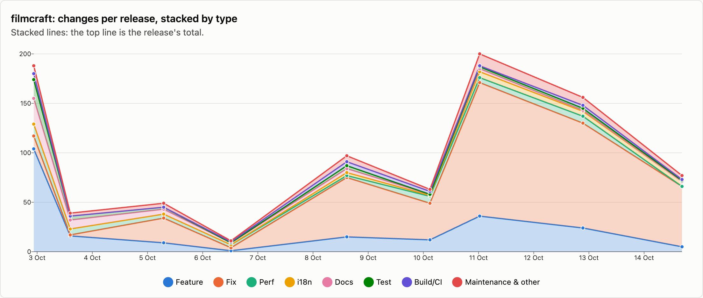
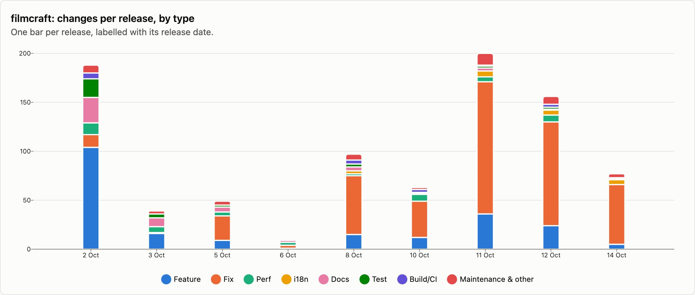
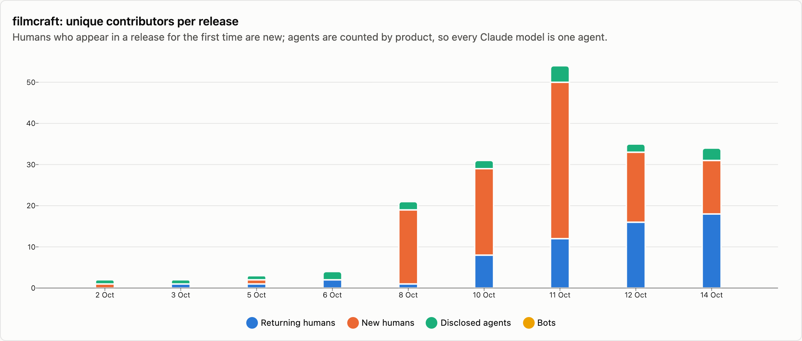
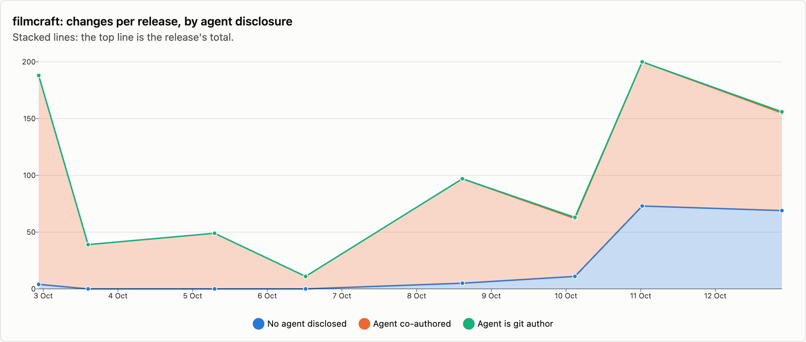

# filmcraft — changes per release

9 releases, 2026-10-02 → 2026-10-14. Each release is counted as the changes that landed between the previous release tag and its own; the first one is everything up to the first tag. See [../README.md](../README.md) for how changes are counted and categorised. The charts cover released changes; the commentary under them is generated from the same numbers.

## Changes by type

<picture>
  <source media="(prefers-color-scheme: dark)" srcset="../charts/dark/filmcraft-changes-line.png">
  
</picture>

<picture>
  <source media="(prefers-color-scheme: dark)" srcset="../charts/dark/filmcraft-changes-bar.png">
  
</picture>

**What this shows**

- filmcraft has had 9 releases with 880 changes in total, over 12 days.
- The biggest release was v0.6.0 (11 Oct) with 200 changes, which is 23% of everything released so far.
- Releases are getting bigger: the first 4 releases averaged 72 changes each and the last 4 releases averaged 124.
- Overall, fixes make up 50% of changes and features 25%.
- The work has shifted from building new things to fixing: features went from 45% of changes in the first 4 releases to 16% in the last 4 releases, and fixes from 15% to 68%.
- Performance work is 5% of changes (46), most of it in v0.1.0 (2 Oct), which had 12.
- After features and fixes, the next biggest group is documentation at 6%.
- Since the last release, 6 more changes have landed on main and not been released yet: 0 features and 4 fixes among them.

| Release | Published | Changes | Feature | Fix | Perf | i18n | Docs | Test | Build/CI | Release | Refactor | Deps | Security | Revert | Other |
|---|--:|--:|--:|--:|--:|--:|--:|--:|--:|--:|--:|--:|--:|--:|--:|
| [v0.1.0](https://github.com/storytold/filmcraft/releases/tag/v0.1.0) | 2026-10-02 | 188 | 104 | 13 | 12 | · | 26 | 19 | 6 | 1 | 5 | 1 | · | · | 1 |
| [v0.1.1](https://github.com/storytold/filmcraft/releases/tag/v0.1.1) | 2026-10-03 | 39 | 16 | 1 | 6 | · | 9 | 4 | · | 1 | 2 | · | · | · | · |
| [v0.2.0](https://github.com/storytold/filmcraft/releases/tag/v0.2.0) | 2026-10-05 | 49 | 9 | 25 | 4 | · | 5 | 2 | · | 1 | 1 | 2 | · | · | · |
| [v0.2.1](https://github.com/storytold/filmcraft/releases/tag/v0.2.1) | 2026-10-06 | 11 | 1 | 3 | 3 | · | 2 | · | 1 | 1 | · | · | · | · | · |
| [v0.4.0](https://github.com/storytold/filmcraft/releases/tag/v0.4.0) | 2026-10-08 | 97 | 15 | 60 | 2 | 3 | 4 | 3 | 4 | 5 | 1 | · | · | · | · |
| [v0.5.0](https://github.com/storytold/filmcraft/releases/tag/v0.5.0) | 2026-10-10 | 63 | 12 | 37 | 7 | 1 | 1 | · | 3 | 1 | 1 | · | · | · | · |
| [v0.6.0](https://github.com/storytold/filmcraft/releases/tag/v0.6.0) | 2026-10-11 | 200 | 36 | 135 | 5 | 6 | 3 | 2 | 1 | 1 | 5 | · | · | 6 | · |
| [v0.7.2](https://github.com/storytold/filmcraft/releases/tag/v0.7.2) | 2026-10-12 | 156 | 24 | 106 | 7 | 5 | 1 | 2 | 3 | 4 | 4 | · | · | · | · |
| [v0.8.0](https://github.com/storytold/filmcraft/releases/tag/v0.8.0) | 2026-10-14 | 77 | 5 | 61 | · | 5 | · | 1 | 1 | 1 | 2 | · | · | · | 1 |
| _unreleased (main)_ | 2026-10-16 | 6 | · | 4 | · | · | · | · | 2 | · | · | · | · | · | · |
| **Released total** |  | **880** | **222** | **441** | **46** | **20** | **51** | **33** | **19** | **16** | **21** | **3** | · | **6** | **2** |

Share of released changes: feature 25%, fix 50%, perf 5%, i18n 2%, docs 6%, test 4%, build/ci 2%, release 2%, refactor 2%, revert 1%.

## How changes landed

**What this shows**

- 67% of changes came in through pull requests; the rest were committed directly.
- That has grown: 13% of changes came in through pull requests in the first 4 releases and 93% in the last 4 releases.
- Of the 591 pull requests, 91% came from people outside the core team.
- Outside contributions have gone up: 30% of pull requests in the first 4 releases, 98% in the last 4 releases.

| Release | Commits | PR merges | Squash merges | Direct commits | Batch commits | Commits inside PRs | Sync merges | Community PRs | Team PRs |
|---|--:|--:|--:|--:|--:|--:|--:|--:|--:|
| [v0.1.0](https://github.com/storytold/filmcraft/releases/tag/v0.1.0) | 235 | · | · | 188 | · | · | 47 | · | · |
| [v0.1.1](https://github.com/storytold/filmcraft/releases/tag/v0.1.1) | 53 | · | · | 39 | · | · | 14 | · | · |
| [v0.2.0](https://github.com/storytold/filmcraft/releases/tag/v0.2.0) | 90 | 26 | · | 23 | · | 31 | 10 | 8 | 18 |
| [v0.2.1](https://github.com/storytold/filmcraft/releases/tag/v0.2.1) | 27 | 10 | 1 | · | · | 16 | · | 3 | 8 |
| [v0.4.0](https://github.com/storytold/filmcraft/releases/tag/v0.4.0) | 245 | 84 | 9 | 4 | · | 132 | 16 | 76 | 17 |
| [v0.5.0](https://github.com/storytold/filmcraft/releases/tag/v0.5.0) | 192 | 61 | 1 | 1 | · | 95 | 34 | 57 | 5 |
| [v0.6.0](https://github.com/storytold/filmcraft/releases/tag/v0.6.0) | 536 | 186 | 2 | 12 | · | 265 | 71 | 186 | 2 |
| [v0.7.2](https://github.com/storytold/filmcraft/releases/tag/v0.7.2) | 382 | 135 | 4 | 17 | · | 178 | 48 | 138 | 1 |
| [v0.8.0](https://github.com/storytold/filmcraft/releases/tag/v0.8.0) | 187 | 71 | 1 | 3 | 2 | 91 | 19 | 72 | · |
| _unreleased (main)_ | 7 | 1 | 5 | · | · | 1 | · | 6 | · |
| **Released total** | **1947** | **573** | **18** | **287** | **2** | **808** | **259** | **540** | **51** |

Changes = PR merges + squash merges + direct commits + batch commits. Commits = changes + commits inside PRs + sync merges.

## Contributors

<picture>
  <source media="(prefers-color-scheme: dark)" srcset="../charts/dark/filmcraft-contributors.png">
  
</picture>

<picture>
  <source media="(prefers-color-scheme: dark)" srcset="../charts/dark/filmcraft-agent-disclosure.png">
  
</picture>

**What this shows**

- 109 people have contributed to released changes.
- The first release had 1 person and the latest had 31; the most in one release was 50, in v0.6.0 (11 Oct).
- In the latest release, 13 of the 31 people were contributing for the first time.
- The most active person, @echelon, authored 38% of all changes, and the three most active authored 53% between them.
- 78% of changes say an AI agent was involved (689 of 880).
- That share has gone down: 99% in the first 4 releases and 63% in the last 4 releases.
- Claude accounts for nearly all of the changes that name an agent; 4 other agents are named on 27 changes between them.
- In 3 changes the agent is the commit author itself, not only a co-author.
- These figures only count changes that say so, so the real share may be higher.

| Release | Humans | New | Changes disclosing an agent | Share | Agent is git author | Agents disclosed | Bots |
|---|--:|--:|--:|--:|--:|---|--:|
| [v0.1.0](https://github.com/storytold/filmcraft/releases/tag/v0.1.0) | 1 | 1 | 184 | 98% | · | Claude | · |
| [v0.1.1](https://github.com/storytold/filmcraft/releases/tag/v0.1.1) | 1 | · | 39 | 100% | · | Claude | · |
| [v0.2.0](https://github.com/storytold/filmcraft/releases/tag/v0.2.0) | 2 | 1 | 49 | 100% | · | Claude | · |
| [v0.2.1](https://github.com/storytold/filmcraft/releases/tag/v0.2.1) | 2 | · | 11 | 100% | · | Claude, OpenAI Codex / ChatGPT | · |
| [v0.4.0](https://github.com/storytold/filmcraft/releases/tag/v0.4.0) | 19 | 18 | 92 | 95% | · | Claude, OpenAI Codex / ChatGPT | · |
| [v0.5.0](https://github.com/storytold/filmcraft/releases/tag/v0.5.0) | 29 | 21 | 52 | 83% | 1 | Claude, OpenAI Codex / ChatGPT | · |
| [v0.6.0](https://github.com/storytold/filmcraft/releases/tag/v0.6.0) | 50 | 38 | 127 | 64% | · | Claude, OpenAI Codex / ChatGPT, Kimi, Xiaomi MiMo | · |
| [v0.7.2](https://github.com/storytold/filmcraft/releases/tag/v0.7.2) | 33 | 17 | 87 | 56% | 1 | Claude, OpenAI Codex / ChatGPT | · |
| [v0.8.0](https://github.com/storytold/filmcraft/releases/tag/v0.8.0) | 31 | 13 | 48 | 62% | 1 | Claude, OpenAI Codex / ChatGPT, GitHub Copilot | · |
| _unreleased (main)_ | 6 | 1 | 3 | 50% | · | OpenAI Codex / ChatGPT | · |
| **Released total** | **109** |  | **689** | 78% | **3** | Claude, OpenAI Codex / ChatGPT, Kimi, GitHub Copilot, Xiaomi MiMo | · |

Humans are unique people per release, authors and co-authors together; New is how many of them had not appeared in an earlier release of this repo. The total row counts each person once. An agent is disclosed when it is a commit's git author, is named in a `Co-authored-by` trailer, or the message says it was generated with one.

Most active humans in released changes: @echelon (867), @vangel76 (87), @MarekSpodBiedry (45), @vbasky (44), @punkhop (26), @ReReddo (25), @haranishi (20), @carlitosteso3 (18), @marcoarnulfo (17), @Ni-zav (16).
