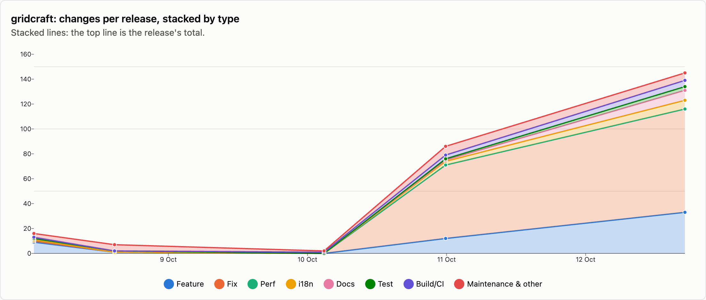
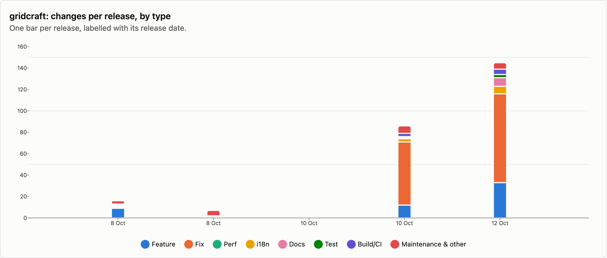
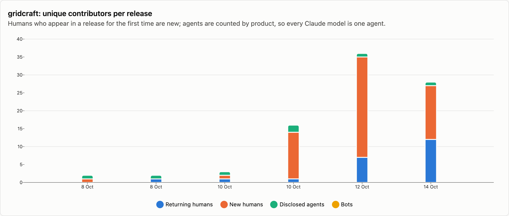
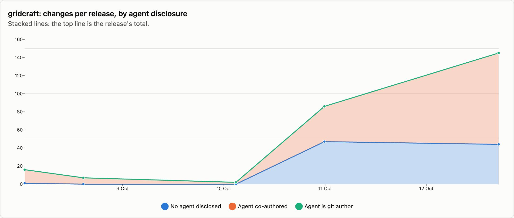

# gridcraft — changes per release

6 releases, 2026-10-08 → 2026-10-14. Each release is counted as the changes that landed between the previous release tag and its own; the first one is everything up to the first tag. See [../README.md](../README.md) for how changes are counted and categorised. The charts cover released changes; the commentary under them is generated from the same numbers.

## Changes by type

<picture>
  <source media="(prefers-color-scheme: dark)" srcset="../charts/dark/gridcraft-changes-line.png">
  
</picture>

<picture>
  <source media="(prefers-color-scheme: dark)" srcset="../charts/dark/gridcraft-changes-bar.png">
  
</picture>

**What this shows**

- gridcraft has had 6 releases with 419 changes in total, over 6 days.
- The biggest release was v0.7.0 (14 Oct) with 163 changes, which is 39% of everything released so far.
- Releases are getting bigger: the first 3 releases averaged 8 changes each and the last 3 releases averaged 131.
- Overall, fixes make up 65% of changes and features 16%.
- The work has shifted from building new things to fixing: features went from 40% of changes in the first 3 releases to 15% in the last 3 releases, and fixes from 4% to 69%.
- Performance work is rare: 2 changes.
- Since the last release, 5 more changes have landed on main and not been released yet: 0 features and 3 fixes among them.

| Release | Published | Changes | Feature | Fix | Perf | i18n | Docs | Test | Build/CI | Release | Refactor | Deps | Security | Revert | Other |
|---|--:|--:|--:|--:|--:|--:|--:|--:|--:|--:|--:|--:|--:|--:|--:|
| [v0.1.0](https://github.com/storytold/gridcraft/releases/tag/v0.1.0) | 2026-10-08 | 16 | 9 | 1 | 1 | · | 1 | · | 1 | · | 2 | · | · | · | 1 |
| [v0.3.0](https://github.com/storytold/gridcraft/releases/tag/v0.3.0) | 2026-10-08 | 7 | 1 | · | · | · | 1 | · | · | 5 | · | · | · | · | · |
| [v0.4.0](https://github.com/storytold/gridcraft/releases/tag/v0.4.0) | 2026-10-10 | 2 | · | · | · | · | · | · | 1 | 1 | · | · | · | · | · |
| [v0.5.0](https://github.com/storytold/gridcraft/releases/tag/v0.5.0) | 2026-10-10 | 86 | 12 | 59 | · | 3 | 1 | 1 | 3 | 2 | 5 | · | · | · | · |
| [v0.6.1](https://github.com/storytold/gridcraft/releases/tag/v0.6.1) | 2026-10-12 | 145 | 33 | 83 | · | 7 | 8 | 3 | 5 | 3 | 2 | · | 1 | · | · |
| [v0.7.0](https://github.com/storytold/gridcraft/releases/tag/v0.7.0) | 2026-10-14 | 163 | 13 | 129 | 1 | 4 | 1 | 8 | 2 | 1 | 3 | · | 1 | · | · |
| _unreleased (main)_ | 2026-10-15 | 5 | · | 3 | · | · | · | · | 2 | · | · | · | · | · | · |
| **Released total** |  | **419** | **68** | **272** | **2** | **14** | **12** | **12** | **12** | **12** | **12** | · | **2** | · | **1** |

Share of released changes: feature 16%, fix 65%, i18n 3%, docs 3%, test 3%, build/ci 3%, release 3%, refactor 3%.

## How changes landed

**What this shows**

- 88% of changes came in through pull requests; the rest were committed directly.
- That has grown: 20% of changes came in through pull requests in the first 3 releases and 92% in the last 3 releases.
- Of the 368 pull requests, 98% came from people outside the core team.
- Outside contributions have gone up: 20% of pull requests in the first 3 releases, over 99% in the last 3 releases.

| Release | Commits | PR merges | Squash merges | Direct commits | Batch commits | Commits inside PRs | Sync merges | Community PRs | Team PRs |
|---|--:|--:|--:|--:|--:|--:|--:|--:|--:|
| [v0.1.0](https://github.com/storytold/gridcraft/releases/tag/v0.1.0) | 16 | · | 1 | 15 | · | · | · | · | 1 |
| [v0.3.0](https://github.com/storytold/gridcraft/releases/tag/v0.3.0) | 7 | · | 3 | 4 | · | · | · | · | 3 |
| [v0.4.0](https://github.com/storytold/gridcraft/releases/tag/v0.4.0) | 3 | 1 | · | 1 | · | 1 | · | 1 | · |
| [v0.5.0](https://github.com/storytold/gridcraft/releases/tag/v0.5.0) | 222 | 78 | 3 | 5 | · | 116 | 20 | 79 | 2 |
| [v0.6.1](https://github.com/storytold/gridcraft/releases/tag/v0.6.1) | 358 | 126 | 6 | 13 | · | 181 | 32 | 131 | 1 |
| [v0.7.0](https://github.com/storytold/gridcraft/releases/tag/v0.7.0) | 408 | 150 | · | 13 | · | 181 | 64 | 150 | · |
| _unreleased (main)_ | 7 | 2 | 3 | · | · | 2 | · | 5 | · |
| **Released total** | **1014** | **355** | **13** | **51** | **0** | **479** | **116** | **361** | **7** |

Changes = PR merges + squash merges + direct commits + batch commits. Commits = changes + commits inside PRs + sync merges.

## Contributors

<picture>
  <source media="(prefers-color-scheme: dark)" srcset="../charts/dark/gridcraft-contributors.png">
  
</picture>

<picture>
  <source media="(prefers-color-scheme: dark)" srcset="../charts/dark/gridcraft-agent-disclosure.png">
  
</picture>

**What this shows**

- 59 people have contributed to released changes.
- The first release had 1 person and the latest had 27; the most in one release was 35, in v0.6.1 (12 Oct).
- In the latest release, 15 of the 27 people were contributing for the first time.
- The most active person, @echelon, authored 13% of all changes, and the three most active authored 48% between them.
- 52% of changes say an AI agent was involved (216 of 419).
- That share has gone down: 96% in the first 3 releases and 49% in the last 3 releases.
- Claude accounts for nearly all of the changes that name an agent; OpenAI Codex / ChatGPT is named on 3 changes.
- In 1 change the agent is the commit author itself, not only a co-author.
- These figures only count changes that say so, so the real share may be higher.

| Release | Humans | New | Changes disclosing an agent | Share | Agent is git author | Agents disclosed | Bots |
|---|--:|--:|--:|--:|--:|---|--:|
| [v0.1.0](https://github.com/storytold/gridcraft/releases/tag/v0.1.0) | 1 | 1 | 15 | 94% | · | Claude | · |
| [v0.3.0](https://github.com/storytold/gridcraft/releases/tag/v0.3.0) | 2 | 1 | 7 | 100% | · | Claude | · |
| [v0.4.0](https://github.com/storytold/gridcraft/releases/tag/v0.4.0) | 2 | 1 | 2 | 100% | · | Claude | · |
| [v0.5.0](https://github.com/storytold/gridcraft/releases/tag/v0.5.0) | 14 | 13 | 39 | 45% | · | Claude, OpenAI Codex / ChatGPT | · |
| [v0.6.1](https://github.com/storytold/gridcraft/releases/tag/v0.6.1) | 35 | 28 | 101 | 70% | · | Claude | · |
| [v0.7.0](https://github.com/storytold/gridcraft/releases/tag/v0.7.0) | 27 | 15 | 52 | 32% | 1 | Claude | · |
| _unreleased (main)_ | 5 | · | 1 | 20% | · | Claude | · |
| **Released total** | **59** |  | **216** | 52% | **1** | Claude, OpenAI Codex / ChatGPT | · |

Humans are unique people per release, authors and co-authors together; New is how many of them had not appeared in an earlier release of this repo. The total row counts each person once. An agent is disclosed when it is a commit's git author, is named in a `Co-authored-by` trailer, or the message says it was generated with one.

Most active humans in released changes: @echelon (411), @MarekSpodBiedry (84), @vangel76 (61), @marcoarnulfo (34), @nihilist-narwhal (34), @harrisonoconnorhover (20), @LloydNicholson (15), @neilcawse (15), @justinjohn0306 (8), @Dejan-Port (6).
