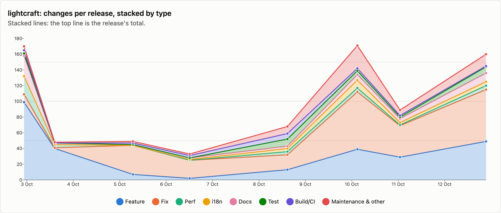
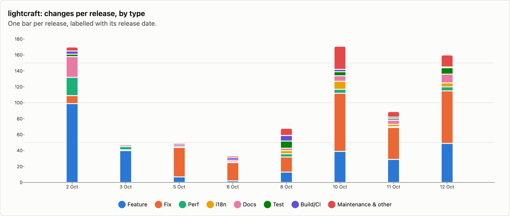
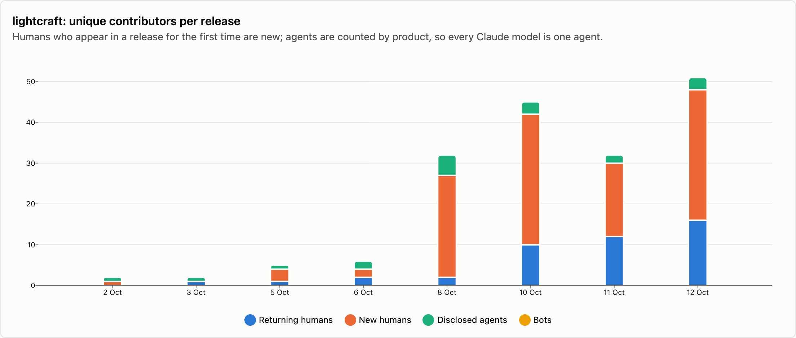
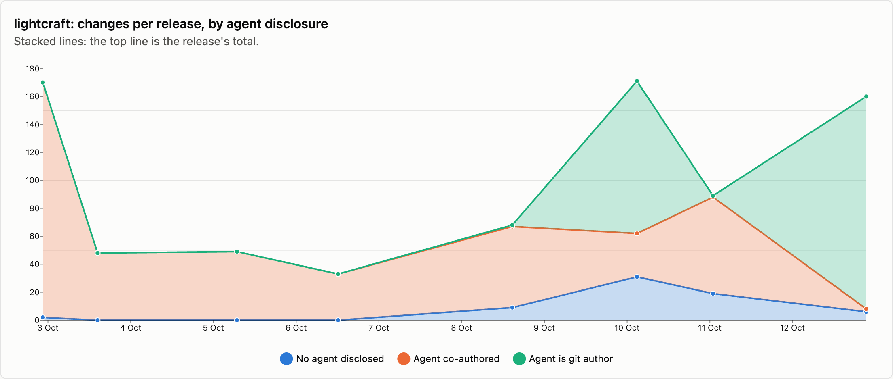

# lightcraft — changes per release

8 releases, 2026-10-02 → 2026-10-12. Each release is counted as the changes that landed between the previous release tag and its own; the first one is everything up to the first tag. See [../README.md](../README.md) for how changes are counted and categorised. The charts cover released changes; the commentary under them is generated from the same numbers.

## Changes by type

<picture>
  <source media="(prefers-color-scheme: dark)" srcset="../charts/dark/lightcraft-changes-line.png">
  
</picture>

<picture>
  <source media="(prefers-color-scheme: dark)" srcset="../charts/dark/lightcraft-changes-bar.png">
  
</picture>

**What this shows**

- lightcraft has had 8 releases with 788 changes in total, over 10 days.
- The biggest release was v0.5.0 (10 Oct) with 171 changes, which is 22% of everything released so far.
- Releases are getting bigger: the first 4 releases averaged 75 changes each and the last 4 releases averaged 122.
- Overall, features make up 35% of changes and fixes 34%.
- The work has shifted from building new things to fixing: features went from 49% of changes in the first 4 releases to 27% in the last 4 releases, and fixes from 24% to 41%.
- Performance work is 5% of changes (42), most of it in v0.1.0 (2 Oct), which had 23.
- After features and fixes, the next biggest group is documentation at 7%.
- Since the last release, 183 more changes have landed on main and not been released yet: 27 features and 112 fixes among them.

| Release | Published | Changes | Feature | Fix | Perf | i18n | Docs | Test | Build/CI | Release | Refactor | Deps | Security | Revert | Other |
|---|--:|--:|--:|--:|--:|--:|--:|--:|--:|--:|--:|--:|--:|--:|--:|
| [v0.1.0](https://github.com/storytold/lightcraft/releases/tag/v0.1.0) | 2026-10-02 | 170 | 99 | 10 | 23 | · | 26 | 3 | 4 | 1 | 3 | · | · | · | 1 |
| [v0.1.1](https://github.com/storytold/lightcraft/releases/tag/v0.1.1) | 2026-10-03 | 48 | 40 | 1 | 4 | · | 2 | · | · | 1 | · | · | · | · | · |
| [v0.2.0](https://github.com/storytold/lightcraft/releases/tag/v0.2.0) | 2026-10-05 | 49 | 7 | 37 | · | · | 1 | · | 2 | 1 | 1 | · | · | · | · |
| [v0.2.1](https://github.com/storytold/lightcraft/releases/tag/v0.2.1) | 2026-10-06 | 33 | 2 | 23 | · | 1 | 2 | · | 3 | 1 | 1 | · | · | · | · |
| [v0.4.0](https://github.com/storytold/lightcraft/releases/tag/v0.4.0) | 2026-10-08 | 68 | 13 | 19 | 4 | 4 | 3 | 9 | 7 | 5 | 3 | · | 1 | · | · |
| [v0.5.0](https://github.com/storytold/lightcraft/releases/tag/v0.5.0) | 2026-10-10 | 171 | 39 | 73 | 5 | 10 | 7 | 5 | 3 | 1 | 7 | · | 1 | · | 20 |
| [v0.6.0](https://github.com/storytold/lightcraft/releases/tag/v0.6.0) | 2026-10-11 | 89 | 29 | 40 | 1 | 3 | 5 | 2 | 2 | 1 | 2 | · | · | · | 4 |
| [v0.7.1](https://github.com/storytold/lightcraft/releases/tag/v0.7.1) | 2026-10-12 | 160 | 49 | 66 | 5 | 5 | 11 | 8 | 1 | 2 | 8 | 1 | · | · | 4 |
| _unreleased (main)_ | 2026-10-14 | 183 | 27 | 112 | 12 | 3 | 4 | 7 | 2 | · | 5 | 1 | 6 | 1 | 3 |
| **Released total** |  | **788** | **278** | **269** | **42** | **23** | **57** | **27** | **22** | **13** | **25** | **1** | **2** | · | **29** |

Share of released changes: feature 35%, fix 34%, perf 5%, i18n 3%, docs 7%, test 3%, build/ci 3%, release 2%, refactor 3%, other 4%.

## How changes landed

**What this shows**

- 58% of changes came in through pull requests; the rest were committed directly.
- That has grown: pull requests were 27% of changes in the first 4 releases and 77% in the last 4 releases.
- Of the 459 pull requests, 75% came from people outside the core team.
- Outside contributions have gone up: 23% of pull requests in the first 4 releases, 86% in the last 4 releases.

| Release | Commits | PR merges | Squash merges | Direct commits | Batch commits | Commits inside PRs | Sync merges | Community PRs | Team PRs |
|---|--:|--:|--:|--:|--:|--:|--:|--:|--:|
| [v0.1.0](https://github.com/storytold/lightcraft/releases/tag/v0.1.0) | 206 | · | · | 170 | · | · | 36 | · | · |
| [v0.1.1](https://github.com/storytold/lightcraft/releases/tag/v0.1.1) | 48 | · | · | 48 | · | · | · | · | · |
| [v0.2.0](https://github.com/storytold/lightcraft/releases/tag/v0.2.0) | 121 | 48 | · | 1 | · | 63 | 9 | 15 | 33 |
| [v0.2.1](https://github.com/storytold/lightcraft/releases/tag/v0.2.1) | 113 | 32 | 1 | · | · | 41 | 39 | 4 | 29 |
| [v0.4.0](https://github.com/storytold/lightcraft/releases/tag/v0.4.0) | 169 | 40 | 5 | 23 | · | 79 | 22 | 33 | 12 |
| [v0.5.0](https://github.com/storytold/lightcraft/releases/tag/v0.5.0) | 461 | 132 | · | 1 | 38 | 260 | 30 | 98 | 34 |
| [v0.6.0](https://github.com/storytold/lightcraft/releases/tag/v0.6.0) | 436 | 77 | 3 | 1 | 8 | 326 | 21 | 75 | 5 |
| [v0.7.1](https://github.com/storytold/lightcraft/releases/tag/v0.7.1) | 386 | 121 | · | 2 | 37 | 184 | 42 | 118 | 3 |
| _unreleased (main)_ | 395 | 170 | 1 | 1 | 11 | 200 | 12 | 168 | 3 |
| **Released total** | **1940** | **450** | **9** | **246** | **83** | **953** | **199** | **343** | **116** |

Changes = PR merges + squash merges + direct commits + batch commits. Commits = changes + commits inside PRs + sync merges.

## Contributors

<picture>
  <source media="(prefers-color-scheme: dark)" srcset="../charts/dark/lightcraft-contributors.png">
  
</picture>

<picture>
  <source media="(prefers-color-scheme: dark)" srcset="../charts/dark/lightcraft-agent-disclosure.png">
  
</picture>

**What this shows**

- 113 people have contributed to released changes.
- The first release had 1 person and the latest had 48.
- In the latest release, 32 of the 48 people were contributing for the first time.
- The most active person, @echelon, authored 41% of all changes, and the three most active authored 53% between them.
- 91% of changes say an AI agent was involved (721 of 788).
- That share has gone down: 99% in the first 4 releases and 87% in the last 4 releases.
- Claude accounts for nearly all of the changes that name an agent; 4 other agents are named on 39 changes between them.
- In 263 changes the agent is the commit author itself, not only a co-author.
- These figures only count changes that say so, so the real share may be higher.

| Release | Humans | New | Changes disclosing an agent | Share | Agent is git author | Agents disclosed | Bots |
|---|--:|--:|--:|--:|--:|---|--:|
| [v0.1.0](https://github.com/storytold/lightcraft/releases/tag/v0.1.0) | 1 | 1 | 168 | 99% | · | Claude | · |
| [v0.1.1](https://github.com/storytold/lightcraft/releases/tag/v0.1.1) | 1 | · | 48 | 100% | · | Claude | · |
| [v0.2.0](https://github.com/storytold/lightcraft/releases/tag/v0.2.0) | 4 | 3 | 49 | 100% | · | Claude | · |
| [v0.2.1](https://github.com/storytold/lightcraft/releases/tag/v0.2.1) | 4 | 2 | 33 | 100% | · | Claude, OpenAI Codex / ChatGPT | · |
| [v0.4.0](https://github.com/storytold/lightcraft/releases/tag/v0.4.0) | 27 | 25 | 59 | 87% | 1 | Claude, OpenAI Codex / ChatGPT, opencode, GitHub Copilot, DeepSeek | · |
| [v0.5.0](https://github.com/storytold/lightcraft/releases/tag/v0.5.0) | 42 | 32 | 140 | 82% | 109 | Claude, OpenAI Codex / ChatGPT, opencode | · |
| [v0.6.0](https://github.com/storytold/lightcraft/releases/tag/v0.6.0) | 30 | 18 | 70 | 79% | 1 | Claude, OpenAI Codex / ChatGPT | · |
| [v0.7.1](https://github.com/storytold/lightcraft/releases/tag/v0.7.1) | 48 | 32 | 154 | 96% | 152 | Claude, OpenAI Codex / ChatGPT, DeepSeek | · |
| _unreleased (main)_ | 51 | 29 | 82 | 45% | 1 | Claude, OpenAI Codex / ChatGPT, GLM (Z.ai), DeepSeek | · |
| **Released total** | **113** |  | **721** | 91% | **263** | Claude, OpenAI Codex / ChatGPT, DeepSeek, opencode, GitHub Copilot | · |

Humans are unique people per release, authors and co-authors together; New is how many of them had not appeared in an earlier release of this repo. The total row counts each person once. An agent is disclosed when it is a commit's git author, is named in a `Co-authored-by` trailer, or the message says it was generated with one.

Most active humans in released changes: @echelon (491), @radialmonster (68), @bflatastic (28), @bitshiftza (22), @nledford (20), @AlexChambers (18), @emmertex (12), @MarekSpodBiedry (11), @Exalted5373 (9), @GlemNL (9).
