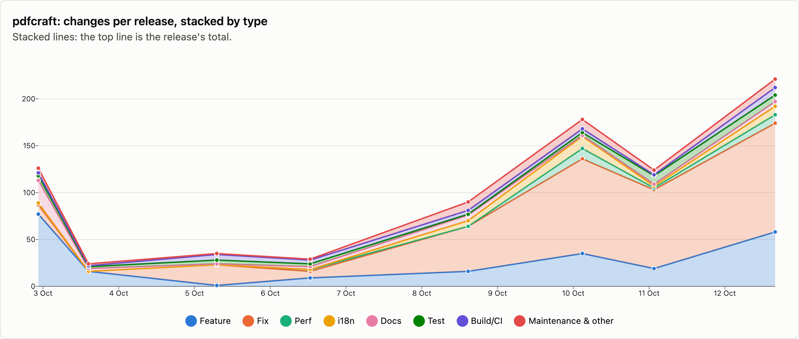
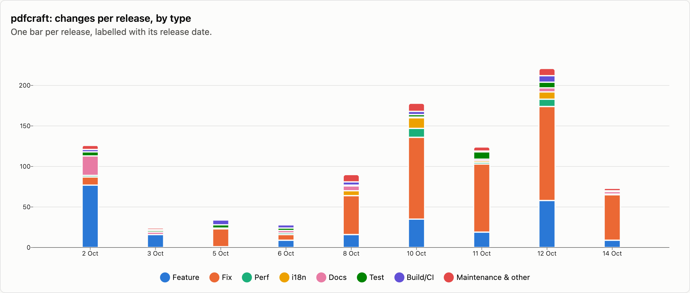
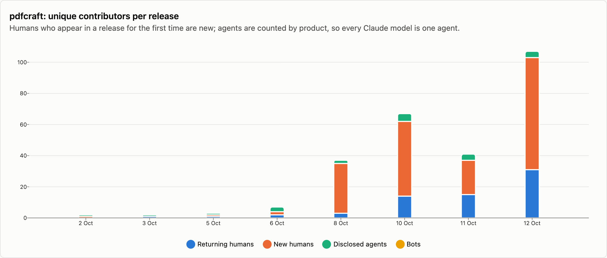
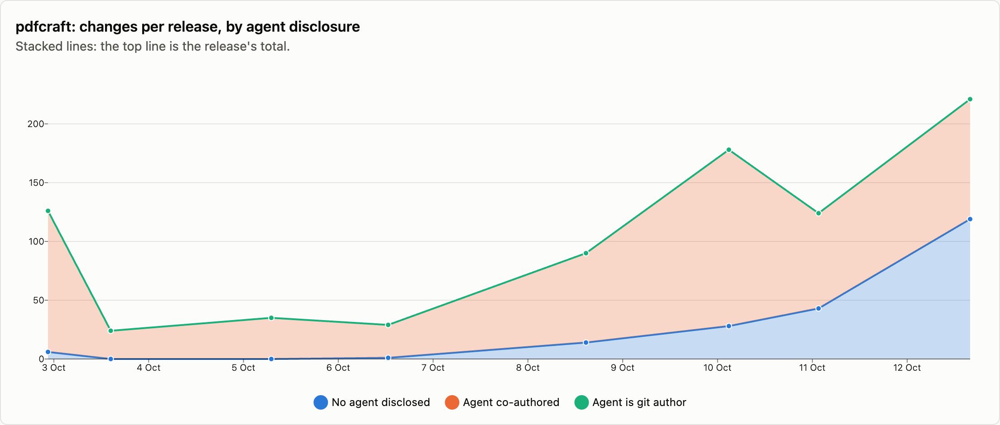

# pdfcraft — changes per release

9 releases, 2026-10-02 → 2026-10-14. Each release is counted as the changes that landed between the previous release tag and its own; the first one is everything up to the first tag. See [../README.md](../README.md) for how changes are counted and categorised. The charts cover released changes; the commentary under them is generated from the same numbers.

## Changes by type

<picture>
  <source media="(prefers-color-scheme: dark)" srcset="../charts/dark/pdfcraft-changes-line.png">
  
</picture>

<picture>
  <source media="(prefers-color-scheme: dark)" srcset="../charts/dark/pdfcraft-changes-bar.png">
  
</picture>

**What this shows**

- pdfcraft has had 9 releases with 900 changes in total, over 12 days.
- The biggest release was v0.7.1 (12 Oct) with 221 changes, which is 25% of everything released so far.
- Releases are getting bigger: the first 4 releases averaged 54 changes each and the last 4 releases averaged 149.
- Overall, fixes make up 49% of changes and features 27%.
- The work has shifted from building new things to fixing: features went from 48% of changes in the first 4 releases to 20% in the last 4 releases, and fixes from 18% to 60%.
- Performance work is 3% of changes (27), most of it in v0.5.0 (10 Oct), which had 11.
- After features and fixes, the next biggest group is documentation at 5%.
- Since the last release, 215 more changes have landed on main and not been released yet: 54 features and 130 fixes among them.

| Release | Published | Changes | Feature | Fix | Perf | i18n | Docs | Test | Build/CI | Release | Refactor | Deps | Security | Revert | Other |
|---|--:|--:|--:|--:|--:|--:|--:|--:|--:|--:|--:|--:|--:|--:|--:|
| [v0.1.0](https://github.com/storytold/pdfcraft/releases/tag/v0.1.0) | 2026-10-02 | 126 | 77 | 10 | 2 | · | 24 | 5 | 3 | · | · | · | · | · | 5 |
| [v0.1.1](https://github.com/storytold/pdfcraft/releases/tag/v0.1.1) | 2026-10-03 | 24 | 16 | · | · | · | 3 | 2 | 1 | 1 | 1 | · | · | · | · |
| [v0.2.0](https://github.com/storytold/pdfcraft/releases/tag/v0.2.0) | 2026-10-05 | 35 | 1 | 22 | · | · | 1 | 4 | 6 | 1 | · | · | · | · | · |
| [v0.2.1](https://github.com/storytold/pdfcraft/releases/tag/v0.2.1) | 2026-10-06 | 29 | 9 | 7 | 2 | · | 3 | 3 | 4 | 1 | · | · | · | · | · |
| [v0.4.0](https://github.com/storytold/pdfcraft/releases/tag/v0.4.0) | 2026-10-08 | 90 | 16 | 48 | · | 6 | 6 | 1 | 4 | 5 | 2 | · | 2 | · | · |
| [v0.5.0](https://github.com/storytold/pdfcraft/releases/tag/v0.5.0) | 2026-10-10 | 178 | 35 | 101 | 11 | 13 | 1 | 3 | 4 | 3 | 4 | · | 3 | · | · |
| [v0.6.0](https://github.com/storytold/pdfcraft/releases/tag/v0.6.0) | 2026-10-11 | 124 | 19 | 84 | 2 | 2 | 2 | 9 | 1 | 1 | 3 | · | 1 | · | · |
| [v0.7.1](https://github.com/storytold/pdfcraft/releases/tag/v0.7.1) | 2026-10-12 | 221 | 58 | 116 | 9 | 9 | 5 | 7 | 8 | 3 | 2 | · | 4 | · | · |
| [v0.8.0](https://github.com/storytold/pdfcraft/releases/tag/v0.8.0) | 2026-10-14 | 73 | 9 | 56 | 1 | · | 3 | · | 1 | 1 | 1 | · | 1 | · | · |
| _unreleased (main)_ | 2026-10-16 | 215 | 54 | 130 | 7 | 4 | 4 | 9 | 2 | · | 3 | · | 2 | · | · |
| **Released total** |  | **900** | **240** | **444** | **27** | **30** | **48** | **34** | **32** | **16** | **13** | · | **11** | · | **5** |

Share of released changes: feature 27%, fix 49%, perf 3%, i18n 3%, docs 5%, test 4%, build/ci 4%, release 2%, refactor 1%, security 1%, other 1%.

## How changes landed

**What this shows**

- 81% of changes came in through pull requests; the rest were committed directly.
- That has grown: 26% of changes came in through pull requests in the first 4 releases and 98% in the last 4 releases.
- Of the 728 pull requests, 87% came from people outside the core team.
- Outside contributions have gone up: 20% of pull requests in the first 4 releases, 95% in the last 4 releases.

| Release | Commits | PR merges | Squash merges | Direct commits | Batch commits | Commits inside PRs | Sync merges | Community PRs | Team PRs |
|---|--:|--:|--:|--:|--:|--:|--:|--:|--:|
| [v0.1.0](https://github.com/storytold/pdfcraft/releases/tag/v0.1.0) | 126 | · | · | 126 | · | · | · | · | · |
| [v0.1.1](https://github.com/storytold/pdfcraft/releases/tag/v0.1.1) | 24 | · | · | 24 | · | · | · | · | · |
| [v0.2.0](https://github.com/storytold/pdfcraft/releases/tag/v0.2.0) | 64 | 17 | 14 | 4 | · | 29 | · | 7 | 24 |
| [v0.2.1](https://github.com/storytold/pdfcraft/releases/tag/v0.2.1) | 33 | 2 | 23 | 4 | · | 4 | · | 4 | 21 |
| [v0.4.0](https://github.com/storytold/pdfcraft/releases/tag/v0.4.0) | 110 | 12 | 73 | 5 | · | 20 | · | 62 | 23 |
| [v0.5.0](https://github.com/storytold/pdfcraft/releases/tag/v0.5.0) | 180 | 1 | 175 | 2 | · | 1 | 1 | 154 | 22 |
| [v0.6.0](https://github.com/storytold/pdfcraft/releases/tag/v0.6.0) | 124 | · | 124 | · | · | · | · | 122 | 2 |
| [v0.7.1](https://github.com/storytold/pdfcraft/releases/tag/v0.7.1) | 230 | 2 | 217 | 2 | · | 3 | 6 | 217 | 2 |
| [v0.8.0](https://github.com/storytold/pdfcraft/releases/tag/v0.8.0) | 73 | · | 68 | 5 | · | · | · | 65 | 3 |
| _unreleased (main)_ | 220 | 3 | 211 | 1 | · | 3 | 2 | 202 | 12 |
| **Released total** | **964** | **34** | **694** | **172** | **0** | **57** | **7** | **631** | **97** |

Changes = PR merges + squash merges + direct commits + batch commits. Commits = changes + commits inside PRs + sync merges.

## Contributors

<picture>
  <source media="(prefers-color-scheme: dark)" srcset="../charts/dark/pdfcraft-contributors.png">
  
</picture>

<picture>
  <source media="(prefers-color-scheme: dark)" srcset="../charts/dark/pdfcraft-agent-disclosure.png">
  
</picture>

**What this shows**

- 188 people have contributed to released changes.
- The first release had 1 person and the latest had 34; the most in one release was 103, in v0.7.1 (12 Oct).
- In the latest release, 10 of the 34 people were contributing for the first time.
- The most active person, @echelon, authored 27% of all changes, and the three most active authored 41% between them.
- 72% of changes say an AI agent was involved (645 of 900).
- That share has gone down: 97% in the first 4 releases and 61% in the last 4 releases.
- The agents named most are Claude (588 changes) and OpenAI Codex / ChatGPT (74).
- These figures only count changes that say so, so the real share may be higher.

| Release | Humans | New | Changes disclosing an agent | Share | Agent is git author | Agents disclosed | Bots |
|---|--:|--:|--:|--:|--:|---|--:|
| [v0.1.0](https://github.com/storytold/pdfcraft/releases/tag/v0.1.0) | 1 | 1 | 120 | 95% | · | Claude | · |
| [v0.1.1](https://github.com/storytold/pdfcraft/releases/tag/v0.1.1) | 1 | · | 24 | 100% | · | Claude | · |
| [v0.2.0](https://github.com/storytold/pdfcraft/releases/tag/v0.2.0) | 2 | 1 | 35 | 100% | · | Claude | · |
| [v0.2.1](https://github.com/storytold/pdfcraft/releases/tag/v0.2.1) | 4 | 2 | 28 | 97% | · | Claude, OpenAI Codex / ChatGPT, GLM (Z.ai) | · |
| [v0.4.0](https://github.com/storytold/pdfcraft/releases/tag/v0.4.0) | 35 | 32 | 76 | 84% | · | Claude, OpenAI Codex / ChatGPT | · |
| [v0.5.0](https://github.com/storytold/pdfcraft/releases/tag/v0.5.0) | 62 | 48 | 150 | 84% | · | Claude, OpenAI Codex / ChatGPT, GLM (Z.ai), GitHub Copilot, Cursor | · |
| [v0.6.0](https://github.com/storytold/pdfcraft/releases/tag/v0.6.0) | 37 | 22 | 81 | 65% | · | Claude, opencode, OpenAI Codex / ChatGPT, GLM (Z.ai) | · |
| [v0.7.1](https://github.com/storytold/pdfcraft/releases/tag/v0.7.1) | 103 | 72 | 102 | 46% | · | Claude, OpenAI Codex / ChatGPT, Muse Spark (Meta), GitHub Copilot | · |
| [v0.8.0](https://github.com/storytold/pdfcraft/releases/tag/v0.8.0) | 34 | 10 | 29 | 40% | · | Claude, OpenAI Codex / ChatGPT | · |
| _unreleased (main)_ | 86 | 42 | 161 | 75% | · | Claude, OpenAI Codex / ChatGPT, GLM (Z.ai), Cursor | · |
| **Released total** | **188** |  | **645** | 72% | **0** | Claude, OpenAI Codex / ChatGPT, opencode, GLM (Z.ai), GitHub Copilot, Muse Spark (Meta), Cursor | · |

Humans are unique people per release, authors and co-authors together; New is how many of them had not appeared in an earlier release of this repo. The total row counts each person once. An agent is disclosed when it is a commit's git author, is named in a `Co-authored-by` trailer, or the message says it was generated with one.

Most active humans in released changes: @echelon (612), @cyfung1031 (88), @marcoarnulfo (40), @jcl-bit (24), @MarekSpodBiedry (23), @earlvanze (22), @bartalos86 (19), @DWAA1660 (19), @Streetblock (19), @LloydNicholson (17).
