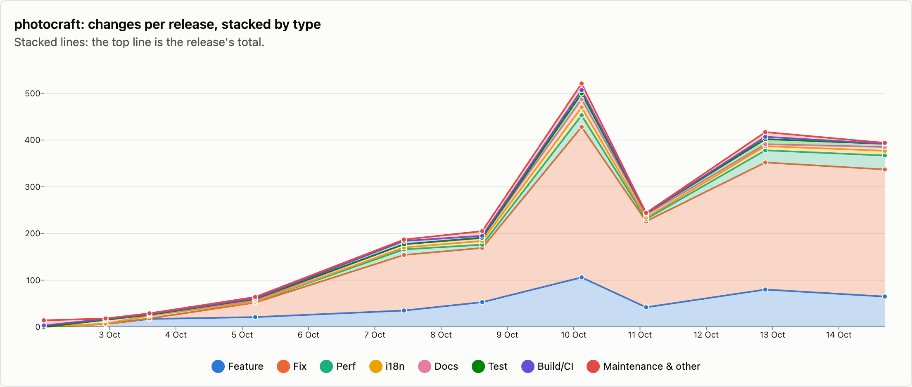
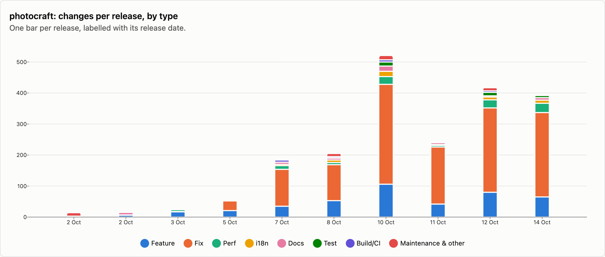
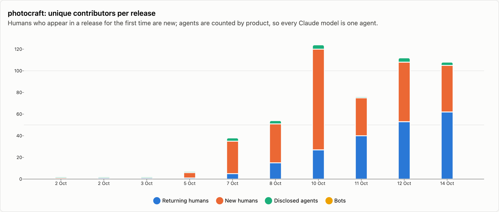
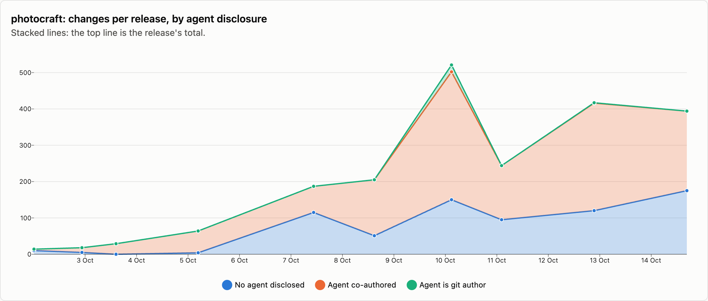

# photocraft — changes per release

10 releases, 2026-10-02 → 2026-10-14. Each release is counted as the changes that landed between the previous release tag and its own; the first one is everything up to the first tag. See [../README.md](../README.md) for how changes are counted and categorised. The charts cover released changes; the commentary under them is generated from the same numbers.

## Changes by type

<picture>
  <source media="(prefers-color-scheme: dark)" srcset="../charts/dark/photocraft-changes-line.png">
  
</picture>

<picture>
  <source media="(prefers-color-scheme: dark)" srcset="../charts/dark/photocraft-changes-bar.png">
  
</picture>

**What this shows**

- photocraft has had 10 releases with 2,093 changes in total, over 12 days.
- The biggest release was v0.6.0 (10 Oct) with 521 changes, which is 25% of everything released so far.
- Releases are getting bigger: the first 5 releases averaged 62 changes each and the last 5 releases averaged 356.
- Overall, fixes make up 63% of changes and features 20%.
- The mix has changed: features went from 25% of changes in the first 5 releases to 19% in the last 5 releases, and fixes from 48% to 65%.
- Performance work is 5% of changes (114), most of it in v0.9.0 (14 Oct), which had 30.
- Since the last release, 251 more changes have landed on main and not been released yet: 47 features and 167 fixes among them.

| Release | Published | Changes | Feature | Fix | Perf | i18n | Docs | Test | Build/CI | Release | Refactor | Deps | Security | Revert | Other |
|---|--:|--:|--:|--:|--:|--:|--:|--:|--:|--:|--:|--:|--:|--:|--:|
| [v0.1.0, v0.1.1-rc.4](https://github.com/storytold/photocraft/releases/tag/v0.1.0) | 2026-10-02 | 14 | · | · | · | · | · | · | 3 | 2 | · | · | · | · | 9 |
| [v0.1.1-rc.5](https://github.com/storytold/photocraft/releases/tag/v0.1.1-rc.5) | 2026-10-02 | 18 | 6 | · | 1 | · | 8 | · | 2 | · | · | · | · | · | 1 |
| [v0.1.1](https://github.com/storytold/photocraft/releases/tag/v0.1.1) | 2026-10-03 | 29 | 17 | 1 | 6 | · | 2 | · | 1 | 1 | 1 | · | · | · | · |
| [v0.2.0](https://github.com/storytold/photocraft/releases/tag/v0.2.0) | 2026-10-05 | 64 | 21 | 31 | 2 | · | 3 | 3 | 1 | 1 | · | · | 2 | · | · |
| [v0.3.0](https://github.com/storytold/photocraft/releases/tag/v0.3.0) | 2026-10-07 | 187 | 35 | 119 | 12 | 4 | 7 | · | 7 | 1 | 1 | · | 1 | · | · |
| [v0.5.0](https://github.com/storytold/photocraft/releases/tag/v0.5.0) | 2026-10-08 | 205 | 53 | 116 | 7 | 8 | 6 | 1 | 4 | 5 | 4 | · | 1 | · | · |
| [v0.6.0](https://github.com/storytold/photocraft/releases/tag/v0.6.0) | 2026-10-10 | 521 | 106 | 322 | 25 | 17 | 17 | 13 | 7 | 1 | 10 | · | 3 | · | · |
| [v0.7.0](https://github.com/storytold/photocraft/releases/tag/v0.7.0) | 2026-10-11 | 244 | 42 | 184 | 5 | 3 | 6 | 3 | · | 1 | · | · | · | · | · |
| [v0.8.2](https://github.com/storytold/photocraft/releases/tag/v0.8.2) | 2026-10-12 | 417 | 80 | 272 | 26 | 9 | 4 | 11 | 5 | 4 | 2 | 1 | 3 | · | · |
| [v0.9.0](https://github.com/storytold/photocraft/releases/tag/v0.9.0) | 2026-10-14 | 394 | 65 | 272 | 30 | 10 | 8 | 7 | · | 1 | 1 | · | · | · | · |
| _unreleased (main)_ | 2026-10-17 | 251 | 47 | 167 | 15 | 3 | 5 | 2 | 8 | · | 3 | · | 1 | · | · |
| **Released total** |  | **2093** | **425** | **1317** | **114** | **51** | **61** | **38** | **30** | **17** | **19** | **1** | **10** | · | **10** |

Share of released changes: feature 20%, fix 63%, perf 5%, i18n 2%, docs 3%, test 2%, build/ci 1%, release 1%, refactor 1%.

## How changes landed

**What this shows**

- 95% of changes came in through pull requests; the rest were committed directly.
- That has grown: pull requests were 77% of changes in the first 5 releases and 98% in the last 5 releases.
- Of the 1,984 pull requests, 84% came from people outside the core team.
- Outside contributions have gone up: 39% of pull requests in the first 5 releases, 90% in the last 5 releases.

| Release | Commits | PR merges | Squash merges | Direct commits | Batch commits | Commits inside PRs | Sync merges | Community PRs | Team PRs |
|---|--:|--:|--:|--:|--:|--:|--:|--:|--:|
| [v0.1.0, v0.1.1-rc.4](https://github.com/storytold/photocraft/releases/tag/v0.1.0) | 14 | · | · | 14 | · | · | · | · | · |
| [v0.1.1-rc.5](https://github.com/storytold/photocraft/releases/tag/v0.1.1-rc.5) | 18 | · | · | 18 | · | · | · | · | · |
| [v0.1.1](https://github.com/storytold/photocraft/releases/tag/v0.1.1) | 29 | · | · | 29 | · | · | · | · | · |
| [v0.2.0](https://github.com/storytold/photocraft/releases/tag/v0.2.0) | 70 | 2 | 50 | 12 | · | 6 | · | 17 | 35 |
| [v0.3.0](https://github.com/storytold/photocraft/releases/tag/v0.3.0) | 187 | · | 187 | · | · | · | · | 77 | 110 |
| [v0.5.0](https://github.com/storytold/photocraft/releases/tag/v0.5.0) | 205 | · | 200 | 5 | · | · | · | 145 | 55 |
| [v0.6.0](https://github.com/storytold/photocraft/releases/tag/v0.6.0) | 566 | 7 | 489 | 25 | · | 30 | 15 | 406 | 90 |
| [v0.7.0](https://github.com/storytold/photocraft/releases/tag/v0.7.0) | 244 | · | 244 | · | · | · | · | 235 | 9 |
| [v0.8.2](https://github.com/storytold/photocraft/releases/tag/v0.8.2) | 422 | 1 | 412 | 4 | · | 2 | 3 | 399 | 14 |
| [v0.9.0](https://github.com/storytold/photocraft/releases/tag/v0.9.0) | 442 | 2 | 390 | 2 | · | 39 | 9 | 387 | 5 |
| _unreleased (main)_ | 277 | 2 | 244 | 5 | · | 17 | 9 | 230 | 16 |
| **Released total** | **2197** | **12** | **1972** | **109** | **0** | **77** | **27** | **1666** | **318** |

Changes = PR merges + squash merges + direct commits + batch commits. Commits = changes + commits inside PRs + sync merges.

## Contributors

<picture>
  <source media="(prefers-color-scheme: dark)" srcset="../charts/dark/photocraft-contributors.png">
  
</picture>

<picture>
  <source media="(prefers-color-scheme: dark)" srcset="../charts/dark/photocraft-agent-disclosure.png">
  
</picture>

**What this shows**

- 298 people have contributed to released changes.
- The first release had 1 person and the latest had 105; the most in one release was 120, in v0.6.0 (10 Oct).
- In the latest release, 43 of the 105 people were contributing for the first time.
- The most active person, @echelon, authored 13% of all changes, and the three most active authored 26% between them.
- 65% of changes say an AI agent was involved (1,368 of 2,093).
- That share has stayed about the same over time (57% in the first 5 releases, 67% in the last 5 releases).
- Claude accounts for nearly all of the changes that name an agent; 6 other agents are named on 53 changes between them.
- In 20 changes the agent is the commit author itself, not only a co-author.
- These figures only count changes that say so, so the real share may be higher.

| Release | Humans | New | Changes disclosing an agent | Share | Agent is git author | Agents disclosed | Bots |
|---|--:|--:|--:|--:|--:|---|--:|
| [v0.1.0, v0.1.1-rc.4](https://github.com/storytold/photocraft/releases/tag/v0.1.0) | 1 | 1 | 4 | 29% | · | Claude | · |
| [v0.1.1-rc.5](https://github.com/storytold/photocraft/releases/tag/v0.1.1-rc.5) | 1 | · | 13 | 72% | · | Claude | · |
| [v0.1.1](https://github.com/storytold/photocraft/releases/tag/v0.1.1) | 1 | · | 29 | 100% | · | Claude | · |
| [v0.2.0](https://github.com/storytold/photocraft/releases/tag/v0.2.0) | 6 | 5 | 60 | 94% | · | Claude | · |
| [v0.3.0](https://github.com/storytold/photocraft/releases/tag/v0.3.0) | 35 | 30 | 72 | 39% | · | Claude, GitHub Copilot, Devin | · |
| [v0.5.0](https://github.com/storytold/photocraft/releases/tag/v0.5.0) | 51 | 36 | 154 | 75% | · | Claude, GitHub Copilot, Qwen | · |
| [v0.6.0](https://github.com/storytold/photocraft/releases/tag/v0.6.0) | 120 | 93 | 371 | 71% | 19 | Claude, OpenAI Codex / ChatGPT, Cursor, GitHub Copilot | · |
| [v0.7.0](https://github.com/storytold/photocraft/releases/tag/v0.7.0) | 75 | 35 | 149 | 61% | · | Claude | · |
| [v0.8.2](https://github.com/storytold/photocraft/releases/tag/v0.8.2) | 108 | 55 | 297 | 71% | 1 | Claude, OpenAI Codex / ChatGPT, Unnamed agent, Cursor | · |
| [v0.9.0](https://github.com/storytold/photocraft/releases/tag/v0.9.0) | 105 | 43 | 219 | 56% | · | Claude, OpenAI Codex / ChatGPT, Cursor | · |
| _unreleased (main)_ | 87 | 31 | 116 | 46% | · | Claude, Cursor, DeepSeek | · |
| **Released total** | **298** |  | **1368** | 65% | **20** | Claude, GitHub Copilot, OpenAI Codex / ChatGPT, Cursor, Unnamed agent, Devin, Qwen | · |

Humans are unique people per release, authors and co-authors together; New is how many of them had not appeared in an earlier release of this repo. The total row counts each person once. An agent is disclosed when it is a commit's git author, is named in a `Co-authored-by` trailer, or the message says it was generated with one.

Most active humans in released changes: @echelon (825), @vangel76 (153), @Ni-zav (128), @bflatastic (118), @davidmann4 (102), @Elvis33LE (44), @MarekSpodBiedry (41), @switch87 (41), @kayrockscreenprinting (40), @itrycodinganditsbad (36).
