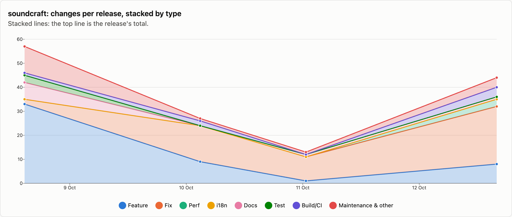
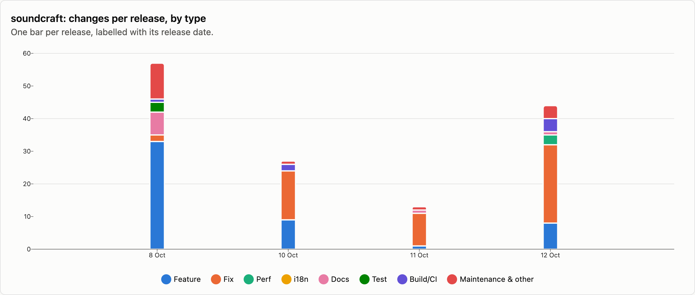
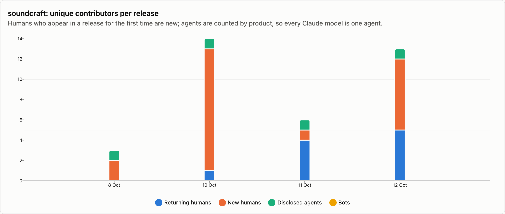
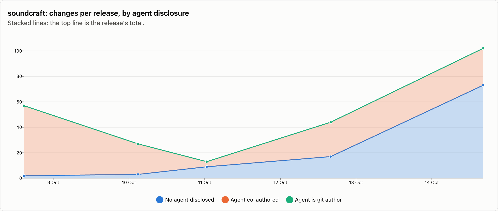

# soundcraft — changes per release

4 releases, 2026-10-08 → 2026-10-12. Each release is counted as the changes that landed between the previous release tag and its own; the first one is everything up to the first tag. See [../README.md](../README.md) for how changes are counted and categorised. The charts cover released changes; the commentary under them is generated from the same numbers.

## Changes by type

<picture>
  <source media="(prefers-color-scheme: dark)" srcset="../charts/dark/soundcraft-changes-line.png">
  
</picture>

<picture>
  <source media="(prefers-color-scheme: dark)" srcset="../charts/dark/soundcraft-changes-bar.png">
  
</picture>

**What this shows**

- soundcraft has had 4 releases with 141 changes in total, over 4 days.
- The biggest release was v0.3.0 (8 Oct) with 57 changes, which is 40% of everything released so far.
- Release size has stayed fairly steady: the first 2 releases averaged 42 changes each and the last 2 releases averaged 28.
- Overall, features make up 36% of changes and fixes 36%.
- The work has shifted from building new things to fixing: features went from 50% of changes in the first 2 releases to 16% in the last 2 releases, and fixes from 20% to 60%.
- Performance work is 2% of changes (3), most of it in v0.6.1 (12 Oct), which had 3.
- After features and fixes, the next biggest group is release housekeeping at 8%.
- Since the last release, 100 more changes have landed on main and not been released yet: 33 features and 58 fixes among them.

| Release | Published | Changes | Feature | Fix | Perf | i18n | Docs | Test | Build/CI | Release | Refactor | Deps | Security | Revert | Other |
|---|--:|--:|--:|--:|--:|--:|--:|--:|--:|--:|--:|--:|--:|--:|--:|
| [v0.3.0](https://github.com/storytold/soundcraft/releases/tag/v0.3.0) | 2026-10-08 | 57 | 33 | 2 | · | · | 7 | 3 | 1 | 6 | 4 | · | · | · | 1 |
| [v0.4.0](https://github.com/storytold/soundcraft/releases/tag/v0.4.0) | 2026-10-10 | 27 | 9 | 15 | · | · | · | · | 2 | 1 | · | · | · | · | · |
| [v0.5.0](https://github.com/storytold/soundcraft/releases/tag/v0.5.0) | 2026-10-11 | 13 | 1 | 10 | · | · | 1 | · | · | 1 | · | · | · | · | · |
| [v0.6.1](https://github.com/storytold/soundcraft/releases/tag/v0.6.1) | 2026-10-12 | 44 | 8 | 24 | 3 | · | 1 | · | 4 | 3 | 1 | · | · | · | · |
| _unreleased (main)_ | 2026-10-13 | 100 | 33 | 58 | 3 | · | 3 | · | · | · | · | · | 3 | · | · |
| **Released total** |  | **141** | **51** | **51** | **3** | · | **9** | **3** | **7** | **11** | **5** | · | · | · | **1** |

Share of released changes: feature 36%, fix 36%, perf 2%, docs 6%, test 2%, build/ci 5%, release 8%, refactor 4%, other 1%.

## How changes landed

**What this shows**

- 60% of changes came in through pull requests; the rest were committed directly.
- That has grown: pull requests were 36% of changes in the first 2 releases and 96% in the last 2 releases.
- Of the 85 pull requests, 88% came from people outside the core team.

| Release | Commits | PR merges | Squash merges | Direct commits | Batch commits | Commits inside PRs | Sync merges | Community PRs | Team PRs |
|---|--:|--:|--:|--:|--:|--:|--:|--:|--:|
| [v0.3.0](https://github.com/storytold/soundcraft/releases/tag/v0.3.0) | 57 | · | 4 | 53 | · | · | · | · | 4 |
| [v0.4.0](https://github.com/storytold/soundcraft/releases/tag/v0.4.0) | 80 | 25 | 1 | 1 | · | 40 | 13 | 25 | 1 |
| [v0.5.0](https://github.com/storytold/soundcraft/releases/tag/v0.5.0) | 31 | 11 | 2 | · | · | 11 | 7 | 11 | 2 |
| [v0.6.1](https://github.com/storytold/soundcraft/releases/tag/v0.6.1) | 139 | 41 | 1 | 2 | · | 67 | 28 | 39 | 3 |
| _unreleased (main)_ | 373 | 98 | 2 | · | · | 189 | 84 | 99 | 1 |
| **Released total** | **307** | **77** | **8** | **56** | **0** | **118** | **48** | **75** | **10** |

Changes = PR merges + squash merges + direct commits + batch commits. Commits = changes + commits inside PRs + sync merges.

## Contributors

<picture>
  <source media="(prefers-color-scheme: dark)" srcset="../charts/dark/soundcraft-contributors.png">
  
</picture>

<picture>
  <source media="(prefers-color-scheme: dark)" srcset="../charts/dark/soundcraft-agent-disclosure.png">
  
</picture>

**What this shows**

- 22 people have contributed to released changes.
- The first release had 2 people and the latest had 12; the most in one release was 13, in v0.4.0 (10 Oct).
- In the latest release, 7 of the 12 people were contributing for the first time.
- The most active person, @echelon, authored 45% of all changes, and the three most active authored 72% between them.
- 78% of changes say an AI agent was involved (110 of 141).
- That share has gone down: 94% in the first 2 releases and 54% in the last 2 releases.
- Claude accounts for all of the changes that name an agent.
- These figures only count changes that say so, so the real share may be higher.

| Release | Humans | New | Changes disclosing an agent | Share | Agent is git author | Agents disclosed | Bots |
|---|--:|--:|--:|--:|--:|---|--:|
| [v0.3.0](https://github.com/storytold/soundcraft/releases/tag/v0.3.0) | 2 | 2 | 55 | 96% | · | Claude | · |
| [v0.4.0](https://github.com/storytold/soundcraft/releases/tag/v0.4.0) | 13 | 12 | 24 | 89% | · | Claude | · |
| [v0.5.0](https://github.com/storytold/soundcraft/releases/tag/v0.5.0) | 5 | 1 | 4 | 31% | · | Claude | · |
| [v0.6.1](https://github.com/storytold/soundcraft/releases/tag/v0.6.1) | 12 | 7 | 27 | 61% | · | Claude | · |
| _unreleased (main)_ | 23 | 15 | 27 | 27% | · | Claude | · |
| **Released total** | **22** |  | **110** | 78% | **0** | Claude | · |

Humans are unique people per release, authors and co-authors together; New is how many of them had not appeared in an earlier release of this repo. The total row counts each person once. An agent is disclosed when it is a commit's git author, is named in a `Co-authored-by` trailer, or the message says it was generated with one.

Most active humans in released changes: @echelon (136), @vbasky (23), @grovebit (15), t (7), @MarekSpodBiedry (6), @h-a-n-a-s-h-i (5), @reoniazx (5), @Garygunn94 (4), @Jafz2001 (4), @salignatmoandal (3).
