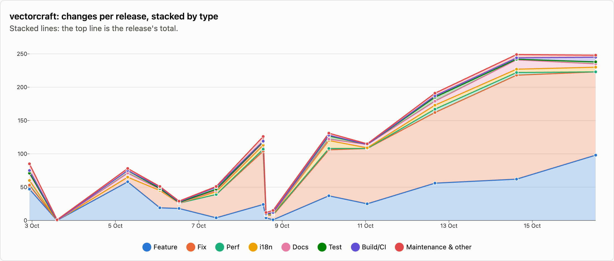
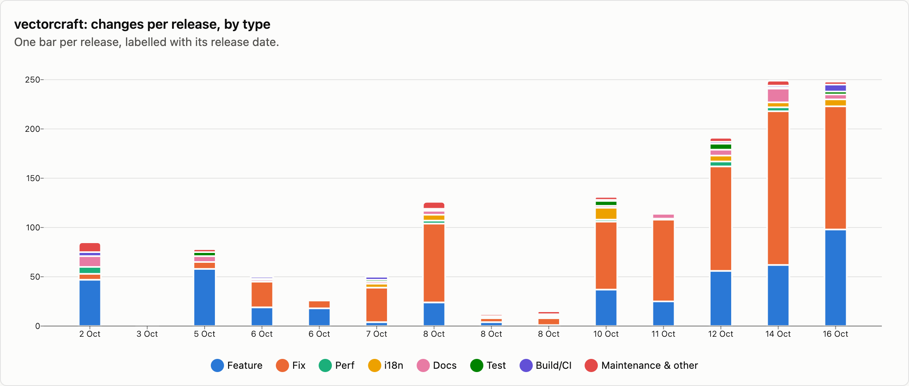
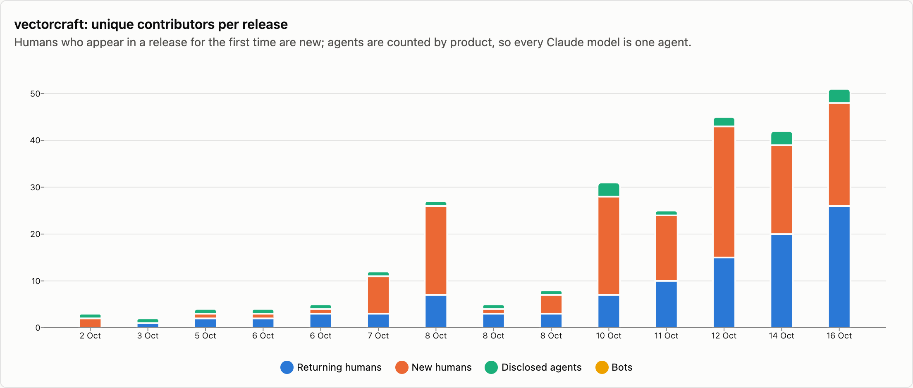
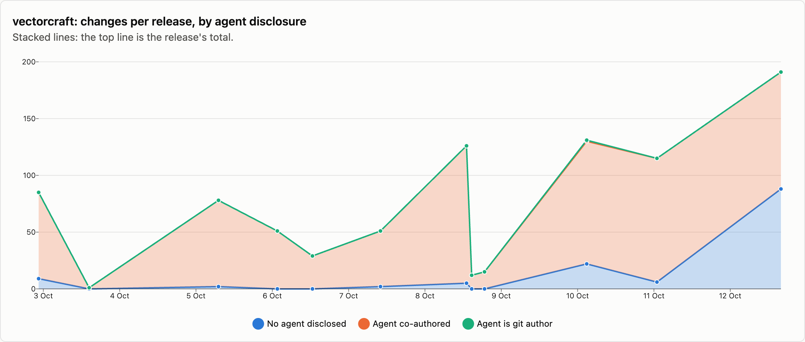

# vectorcraft — changes per release

14 releases, 2026-10-02 → 2026-10-16. Each release is counted as the changes that landed between the previous release tag and its own; the first one is everything up to the first tag. See [../README.md](../README.md) for how changes are counted and categorised. The charts cover released changes; the commentary under them is generated from the same numbers.

## Changes by type

<picture>
  <source media="(prefers-color-scheme: dark)" srcset="../charts/dark/vectorcraft-changes-line.png">
  
</picture>

<picture>
  <source media="(prefers-color-scheme: dark)" srcset="../charts/dark/vectorcraft-changes-bar.png">
  
</picture>

**What this shows**

- vectorcraft has had 14 releases with 1,382 changes in total, over 14 days.
- The biggest release was v0.11.0 (14 Oct) with 249 changes, which is 18% of everything released so far.
- Releases are getting bigger: the first 7 releases averaged 60 changes each and the last 7 releases averaged 137.
- Overall, fixes make up 52% of changes and features 33%.
- The work has shifted from building new things to fixing: features went from 40% of changes in the first 7 releases to 29% in the last 7 releases, and fixes from 38% to 57%.
- Performance work is rare: 22 changes.
- Since the last release, 160 more changes have landed on main and not been released yet: 42 features and 104 fixes among them.

| Release | Published | Changes | Feature | Fix | Perf | i18n | Docs | Test | Build/CI | Release | Refactor | Deps | Security | Revert | Other |
|---|--:|--:|--:|--:|--:|--:|--:|--:|--:|--:|--:|--:|--:|--:|--:|
| [v0.1.0](https://github.com/storytold/vectorcraft/releases/tag/v0.1.0) | 2026-10-02 | 85 | 47 | 6 | 7 | · | 11 | · | 4 | · | 3 | · | · | · | 7 |
| [v0.1.1](https://github.com/storytold/vectorcraft/releases/tag/v0.1.1) | 2026-10-03 | 1 | · | · | · | · | · | · | · | 1 | · | · | · | · | · |
| [v0.2.0](https://github.com/storytold/vectorcraft/releases/tag/v0.2.0) | 2026-10-05 | 78 | 58 | 7 | · | · | 6 | 4 | · | 1 | 1 | · | 1 | · | · |
| [v0.3.0](https://github.com/storytold/vectorcraft/releases/tag/v0.3.0) | 2026-10-06 | 51 | 19 | 26 | · | · | 2 | 1 | 2 | 1 | · | · | · | · | · |
| [v0.3.1](https://github.com/storytold/vectorcraft/releases/tag/v0.3.1) | 2026-10-06 | 29 | 18 | 8 | · | · | · | 1 | 1 | 1 | · | · | · | · | · |
| [v0.4.0](https://github.com/storytold/vectorcraft/releases/tag/v0.4.0) | 2026-10-07 | 51 | 4 | 35 | · | 4 | 2 | 2 | 3 | 1 | · | · | · | · | · |
| [v0.5.0](https://github.com/storytold/vectorcraft/releases/tag/v0.5.0) | 2026-10-08 | 126 | 24 | 80 | 3 | 6 | 4 | 1 | 1 | 3 | 3 | · | · | 1 | · |
| [v0.6.0](https://github.com/storytold/vectorcraft/releases/tag/v0.6.0) | 2026-10-08 | 12 | 4 | 4 | · | · | 1 | · | 1 | 2 | · | · | · | · | · |
| [v0.7.0](https://github.com/storytold/vectorcraft/releases/tag/v0.7.0) | 2026-10-08 | 15 | 1 | 7 | 1 | 1 | 1 | 1 | · | 1 | · | · | · | · | 2 |
| [v0.8.0](https://github.com/storytold/vectorcraft/releases/tag/v0.8.0) | 2026-10-10 | 131 | 37 | 69 | 2 | 12 | 2 | 5 | 1 | 1 | 2 | · | · | · | · |
| [v0.9.0](https://github.com/storytold/vectorcraft/releases/tag/v0.9.0) | 2026-10-11 | 115 | 25 | 83 | · | 1 | 5 | · | · | 1 | · | · | · | · | · |
| [v0.10.0](https://github.com/storytold/vectorcraft/releases/tag/v0.10.0) | 2026-10-12 | 191 | 56 | 106 | 5 | 6 | 6 | 6 | 2 | 2 | 1 | · | 1 | · | · |
| [v0.11.0](https://github.com/storytold/vectorcraft/releases/tag/v0.11.0) | 2026-10-14 | 249 | 62 | 156 | 4 | 5 | 14 | 1 | 2 | 1 | · | · | 4 | · | · |
| [v0.12.0](https://github.com/storytold/vectorcraft/releases/tag/v0.12.0) | 2026-10-16 | 248 | 98 | 125 | · | 7 | 5 | 3 | 7 | 1 | 2 | · | · | · | · |
| _unreleased (main)_ | 2026-10-17 | 160 | 42 | 104 | · | 9 | 2 | 3 | · | · | · | · | · | · | · |
| **Released total** |  | **1382** | **453** | **712** | **22** | **42** | **59** | **25** | **24** | **17** | **12** | · | **6** | **1** | **9** |

Share of released changes: feature 33%, fix 52%, perf 2%, i18n 3%, docs 4%, test 2%, build/ci 2%, release 1%, refactor 1%, other 1%.

## How changes landed

**What this shows**

- 89% of changes came in through pull requests; the rest were committed directly.
- Of the 1,229 pull requests, 59% came from people outside the core team.
- Outside contributions have gone up: 31% of pull requests in the first 7 releases, 68% in the last 7 releases.

| Release | Commits | PR merges | Squash merges | Direct commits | Batch commits | Commits inside PRs | Sync merges | Community PRs | Team PRs |
|---|--:|--:|--:|--:|--:|--:|--:|--:|--:|
| [v0.1.0](https://github.com/storytold/vectorcraft/releases/tag/v0.1.0) | 89 | 1 | · | 84 | · | 4 | · | · | 1 |
| [v0.1.1](https://github.com/storytold/vectorcraft/releases/tag/v0.1.1) | 1 | · | · | 1 | · | · | · | · | · |
| [v0.2.0](https://github.com/storytold/vectorcraft/releases/tag/v0.2.0) | 309 | 77 | · | 1 | · | 213 | 18 | 7 | 70 |
| [v0.3.0](https://github.com/storytold/vectorcraft/releases/tag/v0.3.0) | 117 | 50 | 1 | · | · | 66 | · | 2 | 49 |
| [v0.3.1](https://github.com/storytold/vectorcraft/releases/tag/v0.3.1) | 85 | 29 | · | · | · | 55 | 1 | 4 | 25 |
| [v0.4.0](https://github.com/storytold/vectorcraft/releases/tag/v0.4.0) | 116 | 51 | · | · | · | 60 | 5 | 29 | 22 |
| [v0.5.0](https://github.com/storytold/vectorcraft/releases/tag/v0.5.0) | 301 | 111 | 2 | 13 | · | 173 | 2 | 59 | 54 |
| [v0.6.0](https://github.com/storytold/vectorcraft/releases/tag/v0.6.0) | 24 | 9 | 2 | 1 | · | 12 | · | 4 | 7 |
| [v0.7.0](https://github.com/storytold/vectorcraft/releases/tag/v0.7.0) | 56 | 15 | · | · | · | 31 | 10 | 1 | 14 |
| [v0.8.0](https://github.com/storytold/vectorcraft/releases/tag/v0.8.0) | 355 | 84 | · | 47 | · | 142 | 82 | 35 | 49 |
| [v0.9.0](https://github.com/storytold/vectorcraft/releases/tag/v0.9.0) | 324 | 112 | 3 | · | · | 208 | 1 | 44 | 71 |
| [v0.10.0](https://github.com/storytold/vectorcraft/releases/tag/v0.10.0) | 480 | 190 | · | 1 | · | 287 | 2 | 139 | 51 |
| [v0.11.0](https://github.com/storytold/vectorcraft/releases/tag/v0.11.0) | 582 | 248 | · | 1 | · | 332 | 1 | 157 | 91 |
| [v0.12.0](https://github.com/storytold/vectorcraft/releases/tag/v0.12.0) | 574 | 243 | 1 | 4 | · | 322 | 4 | 238 | 6 |
| _unreleased (main)_ | 370 | 160 | · | · | · | 208 | 2 | 151 | 9 |
| **Released total** | **3413** | **1220** | **9** | **153** | **0** | **1905** | **126** | **719** | **510** |

Changes = PR merges + squash merges + direct commits + batch commits. Commits = changes + commits inside PRs + sync merges.

## Contributors

<picture>
  <source media="(prefers-color-scheme: dark)" srcset="../charts/dark/vectorcraft-contributors.png">
  
</picture>

<picture>
  <source media="(prefers-color-scheme: dark)" srcset="../charts/dark/vectorcraft-agent-disclosure.png">
  
</picture>

**What this shows**

- 141 people have contributed to released changes.
- The first release had 2 people and the latest had 48.
- In the latest release, 22 of the 48 people were contributing for the first time.
- The most active person, @bflatastic, authored 38% of all changes, and the three most active authored 60% between them.
- 60% of changes say an AI agent was involved (832 of 1,382).
- That share has gone down: 96% in the first 7 releases and 45% in the last 7 releases.
- Claude accounts for nearly all of the changes that name an agent; 2 other agents are named on 32 changes between them.
- In 2 changes the agent is the commit author itself, not only a co-author.
- These figures only count changes that say so, so the real share may be higher.

| Release | Humans | New | Changes disclosing an agent | Share | Agent is git author | Agents disclosed | Bots |
|---|--:|--:|--:|--:|--:|---|--:|
| [v0.1.0](https://github.com/storytold/vectorcraft/releases/tag/v0.1.0) | 2 | 2 | 76 | 89% | · | Claude | · |
| [v0.1.1](https://github.com/storytold/vectorcraft/releases/tag/v0.1.1) | 1 | · | 1 | 100% | · | Claude | · |
| [v0.2.0](https://github.com/storytold/vectorcraft/releases/tag/v0.2.0) | 3 | 1 | 76 | 97% | · | Claude | · |
| [v0.3.0](https://github.com/storytold/vectorcraft/releases/tag/v0.3.0) | 3 | 1 | 51 | 100% | · | Claude | · |
| [v0.3.1](https://github.com/storytold/vectorcraft/releases/tag/v0.3.1) | 4 | 1 | 29 | 100% | · | Claude | · |
| [v0.4.0](https://github.com/storytold/vectorcraft/releases/tag/v0.4.0) | 11 | 8 | 49 | 96% | · | Claude | · |
| [v0.5.0](https://github.com/storytold/vectorcraft/releases/tag/v0.5.0) | 26 | 19 | 121 | 96% | · | Claude | · |
| [v0.6.0](https://github.com/storytold/vectorcraft/releases/tag/v0.6.0) | 4 | 1 | 12 | 100% | · | Claude | · |
| [v0.7.0](https://github.com/storytold/vectorcraft/releases/tag/v0.7.0) | 7 | 4 | 15 | 100% | · | Claude | · |
| [v0.8.0](https://github.com/storytold/vectorcraft/releases/tag/v0.8.0) | 28 | 21 | 109 | 83% | 1 | Claude, OpenAI Codex / ChatGPT, Cursor | · |
| [v0.9.0](https://github.com/storytold/vectorcraft/releases/tag/v0.9.0) | 24 | 14 | 109 | 95% | · | Claude | · |
| [v0.10.0](https://github.com/storytold/vectorcraft/releases/tag/v0.10.0) | 43 | 28 | 103 | 54% | · | Claude, OpenAI Codex / ChatGPT | · |
| [v0.11.0](https://github.com/storytold/vectorcraft/releases/tag/v0.11.0) | 39 | 19 | 22 | 9% | · | Claude, OpenAI Codex / ChatGPT, Cursor | · |
| [v0.12.0](https://github.com/storytold/vectorcraft/releases/tag/v0.12.0) | 48 | 22 | 59 | 24% | 1 | Claude, Cursor, OpenAI Codex / ChatGPT | · |
| _unreleased (main)_ | 23 | 8 | 44 | 28% | · | Claude, OpenAI Codex / ChatGPT | · |
| **Released total** | **141** |  | **832** | 60% | **2** | Claude, OpenAI Codex / ChatGPT, Cursor | · |

Humans are unique people per release, authors and co-authors together; New is how many of them had not appeared in an earlier release of this repo. The total row counts each person once. An agent is disclosed when it is a commit's git author, is named in a `Co-authored-by` trailer, or the message says it was generated with one.

Most active humans in released changes: @bflatastic (1202), @dotCooCoo (184), @echelon (156), @theironchef (39), @marcoarnulfo (35), @switch87 (35), @AyberkA0 (25), @imachus (24), @Ni-zav (21), @haranishi (20).
