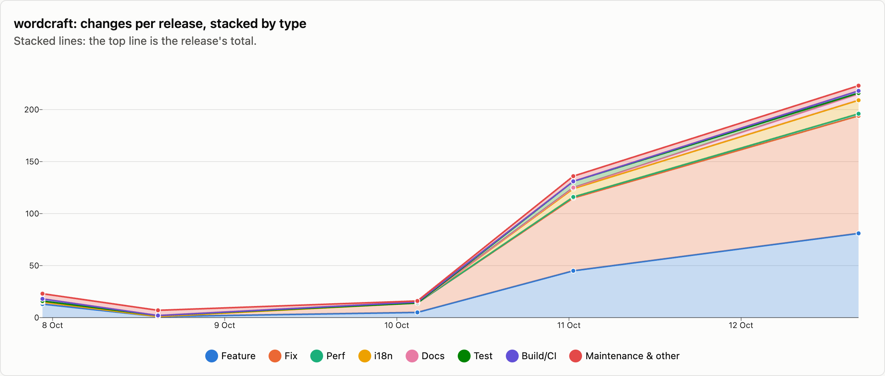
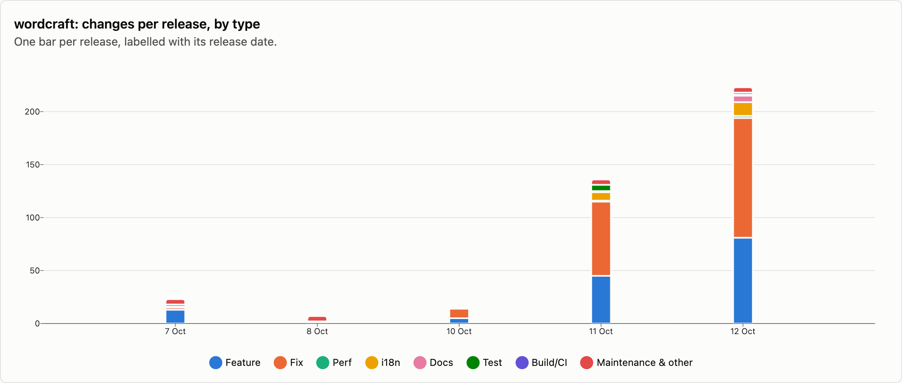
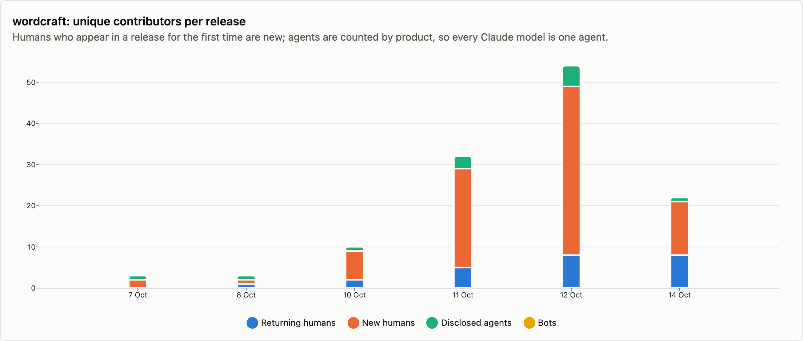
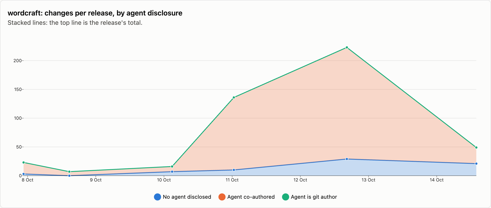

# wordcraft — changes per release

6 releases, 2026-10-07 → 2026-10-14. Each release is counted as the changes that landed between the previous release tag and its own; the first one is everything up to the first tag. See [../README.md](../README.md) for how changes are counted and categorised. The charts cover released changes; the commentary under them is generated from the same numbers.

## Changes by type

<picture>
  <source media="(prefers-color-scheme: dark)" srcset="../charts/dark/wordcraft-changes-line.png">
  
</picture>

<picture>
  <source media="(prefers-color-scheme: dark)" srcset="../charts/dark/wordcraft-changes-bar.png">
  
</picture>

**What this shows**

- wordcraft has had 6 releases with 454 changes in total, over 7 days.
- The biggest release was v0.6.1 (12 Oct) with 223 changes, which is 49% of everything released so far.
- Releases are getting bigger: the first 3 releases averaged 15 changes each and the last 3 releases averaged 136.
- Overall, fixes make up 50% of changes and features 33%.
- The mix has changed: features went from 41% of changes in the first 3 releases to 33% in the last 3 releases, and fixes from 24% to 53%.
- Performance work is rare: 6 changes.
- After features and fixes, the next biggest group is translations at 5%.
- Since the last release, 270 more changes have landed on main and not been released yet: 39 features and 184 fixes among them.

| Release | Published | Changes | Feature | Fix | Perf | i18n | Docs | Test | Build/CI | Release | Refactor | Deps | Security | Revert | Other |
|---|--:|--:|--:|--:|--:|--:|--:|--:|--:|--:|--:|--:|--:|--:|--:|
| [v0.1.0](https://github.com/storytold/wordcraft/releases/tag/v0.1.0) | 2026-10-07 | 23 | 13 | 2 | · | · | 1 | · | 2 | 2 | 2 | · | · | · | 1 |
| [v0.3.0](https://github.com/storytold/wordcraft/releases/tag/v0.3.0) | 2026-10-08 | 7 | 1 | · | · | · | 1 | · | · | 5 | · | · | · | · | · |
| [v0.4.0](https://github.com/storytold/wordcraft/releases/tag/v0.4.0) | 2026-10-10 | 16 | 5 | 9 | · | · | · | · | 1 | 1 | · | · | · | · | · |
| [v0.5.0](https://github.com/storytold/wordcraft/releases/tag/v0.5.0) | 2026-10-11 | 136 | 45 | 70 | 1 | 8 | 1 | 6 | · | 1 | 2 | · | 2 | · | · |
| [v0.6.1](https://github.com/storytold/wordcraft/releases/tag/v0.6.1) | 2026-10-12 | 223 | 81 | 113 | 2 | 13 | 6 | 1 | 2 | 3 | · | · | 2 | · | · |
| [v0.7.0](https://github.com/storytold/wordcraft/releases/tag/v0.7.0) | 2026-10-14 | 49 | 7 | 33 | 3 | 2 | 1 | 2 | · | 1 | · | · | · | · | · |
| _unreleased (main)_ | 2026-10-15 | 270 | 39 | 184 | 2 | 12 | 7 | · | 17 | · | 2 | 2 | 5 | · | · |
| **Released total** |  | **454** | **152** | **227** | **6** | **23** | **10** | **9** | **5** | **13** | **4** | · | **4** | · | **1** |

Share of released changes: feature 33%, fix 50%, perf 1%, i18n 5%, docs 2%, test 2%, build/ci 1%, release 3%, refactor 1%, security 1%.

## How changes landed

**What this shows**

- 93% of changes came in through pull requests; the rest were committed directly.
- That has grown: 46% of changes came in through pull requests in the first 3 releases and 98% in the last 3 releases.
- Of the 422 pull requests, 91% came from people outside the core team.

| Release | Commits | PR merges | Squash merges | Direct commits | Batch commits | Commits inside PRs | Sync merges | Community PRs | Team PRs |
|---|--:|--:|--:|--:|--:|--:|--:|--:|--:|
| [v0.1.0](https://github.com/storytold/wordcraft/releases/tag/v0.1.0) | 23 | · | 3 | 20 | · | · | · | 2 | 1 |
| [v0.3.0](https://github.com/storytold/wordcraft/releases/tag/v0.3.0) | 7 | · | 3 | 4 | · | · | · | · | 3 |
| [v0.4.0](https://github.com/storytold/wordcraft/releases/tag/v0.4.0) | 16 | · | 15 | 1 | · | · | · | 15 | · |
| [v0.5.0](https://github.com/storytold/wordcraft/releases/tag/v0.5.0) | 136 | · | 132 | 4 | · | · | · | 126 | 6 |
| [v0.6.1](https://github.com/storytold/wordcraft/releases/tag/v0.6.1) | 223 | · | 221 | 2 | · | · | · | 193 | 28 |
| [v0.7.0](https://github.com/storytold/wordcraft/releases/tag/v0.7.0) | 56 | 1 | 47 | 1 | · | 2 | 5 | 47 | 1 |
| _unreleased (main)_ | 274 | 1 | 266 | 3 | · | 1 | 3 | 250 | 17 |
| **Released total** | **461** | **1** | **421** | **32** | **0** | **2** | **5** | **383** | **39** |

Changes = PR merges + squash merges + direct commits + batch commits. Commits = changes + commits inside PRs + sync merges.

## Contributors

<picture>
  <source media="(prefers-color-scheme: dark)" srcset="../charts/dark/wordcraft-contributors.png">
  
</picture>

<picture>
  <source media="(prefers-color-scheme: dark)" srcset="../charts/dark/wordcraft-agent-disclosure.png">
  
</picture>

**What this shows**

- 88 people have contributed to released changes.
- The first release had 2 people and the latest had 21; the most in one release was 49, in v0.6.1 (12 Oct).
- In the latest release, 13 of the 21 people were contributing for the first time.
- The most active person, @echelon, authored 15% of all changes, and the three most active authored 57% between them.
- 85% of changes say an AI agent was involved (384 of 454).
- That share has stayed about the same over time (78% in the first 3 releases, 85% in the last 3 releases).
- Claude accounts for nearly all of the changes that name an agent; 5 other agents are named on 9 changes between them.
- These figures only count changes that say so, so the real share may be higher.

| Release | Humans | New | Changes disclosing an agent | Share | Agent is git author | Agents disclosed | Bots |
|---|--:|--:|--:|--:|--:|---|--:|
| [v0.1.0](https://github.com/storytold/wordcraft/releases/tag/v0.1.0) | 2 | 2 | 20 | 87% | · | Claude | · |
| [v0.3.0](https://github.com/storytold/wordcraft/releases/tag/v0.3.0) | 2 | 1 | 7 | 100% | · | Claude | · |
| [v0.4.0](https://github.com/storytold/wordcraft/releases/tag/v0.4.0) | 9 | 7 | 9 | 56% | · | Claude | · |
| [v0.5.0](https://github.com/storytold/wordcraft/releases/tag/v0.5.0) | 29 | 24 | 126 | 93% | · | Claude, OpenAI Codex / ChatGPT, Unnamed agent | · |
| [v0.6.1](https://github.com/storytold/wordcraft/releases/tag/v0.6.1) | 49 | 41 | 194 | 87% | · | Claude, Cursor, OpenAI Codex / ChatGPT, GitHub Copilot, Devin | · |
| [v0.7.0](https://github.com/storytold/wordcraft/releases/tag/v0.7.0) | 21 | 13 | 28 | 57% | · | Claude | · |
| _unreleased (main)_ | 86 | 57 | 180 | 67% | · | Claude, OpenAI Codex / ChatGPT | · |
| **Released total** | **88** |  | **384** | 85% | **0** | Claude, OpenAI Codex / ChatGPT, Cursor, Devin, GitHub Copilot, Unnamed agent | · |

Humans are unique people per release, authors and co-authors together; New is how many of them had not appeared in an earlier release of this repo. The total row counts each person once. An agent is disclosed when it is a commit's git author, is named in a `Co-authored-by` trailer, or the message says it was generated with one.

Most active humans in released changes: @echelon (358), @vangel76 (128), @dkhlapov (66), @MarekSpodBiedry (27), @naxvog (15), @goldsbd (10), @h-a-n-a-s-h-i (9), @LloydNicholson (8), @rabis7575 (7), @edurbs (6).
